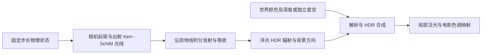

# 归墟白洞模拟

成型归墟的主黑洞显示后，在聊天栏执行 `/shanhai bh white host on`，即可在原位切成白洞。命令回显归墟控制器的坐标。`/shanhai bh white host off` 恢复机器「渲染参数」里的模式。调试覆盖仅对当前客户端、当前世界和指定控制器生效，换维度或退出世界后清除。机器面板设置的克尔黑洞、旧版黑洞或白洞模式随存档保留，并同步到客户端。

`/shanhai bh white on` 可以放出独立预览。默认中心位于镜头前方约 40 个引力半径，也可用 `/shanhai bh center <x> <y> <z>` 指定。当附近主机接管洞心时，以主机模式为准。

`/shanhai bh white demo` 直接打开屏幕居中的电影预设，以独立星空代替当前世界画面。无需寻找空旷位置、放置机器或拥有服务器权限。演示只影响自己的客户端，即使当前世界屏幕被方块遮挡也能观察。用 `/shanhai bh white panel` 调整参数，用 `/shanhai bh white off` 退出。

主机白洞和演示默认使用同一套电影辐射预设。主机喷流以归墟环心为原点，沿机器的竖轴发射。白洞、克尔黑洞和旧版黑洞互斥。切换会重置光线历史、曝光和质量反馈。白洞面板里的光学与 HDR 参数独立于 `/shanhai bh kerr`。黑洞的吸入粒子、中心光柱和向洞心进料的光束只在黑洞模式提交。

`/shanhai bh white panel` 打开观测台。播放页提供暂停、单步、爆发、时间倍率、随机种子和十种预设。物理页调整基准质量、无量纲自旋、外流速度、辐射功率、温度、物质流量及观察者沿视线的速度。视觉页控制体积核心、盘面、喷流和光谱，并可进入现有光学与 HDR 面板。预设保存在客户端配置目录的 `gt_shanhai/white_hole_preview.json`，包含种子、物理参数和材质参数，可将文件复制到另一个客户端。也可通过 `/shanhai bh white seed <value>` 指定种子。

## 独立交互演示

在项目根目录用 JDK 21 运行。需要能创建 OpenGL 3.3 上下文的显卡或驱动。

```powershell
.\gradle-install\gradle-8.8\bin\gradle.bat --offline whiteHoleGpuProbe --args=--interactive
```

拖动鼠标绕白洞观察，滚轮改变视距。空格暂停，N 单步，B 爆发，R 重置，A 自动绕行，G 更换种子。J 切换喷流，S 切换光谱，M 切换史瓦西或克尔几何，Q 切换质量，E 切换自动曝光，方向键调整曝光和自旋，方括号调整外流速度，U/I 调整观察者沿视线的速度，减号和等号调整时间倍率。P 保存当前 PNG，O 导出增加采样的帧，F11 全屏，Esc 退出。输出位于 `build/reports/white-hole-gl`。

## 物理与工程接口

物理引擎不依赖 Minecraft。长度归一化以当前质量的 `GM/c²` 为准，物理输入使用 SI；自旋、电荷和速度比例无量纲。模拟以 120 Hz 固定步长推进，并对显示状态插值。相同参数、种子和操作序列产生可复现的状态。质量损失分别累计远处测量的辐射能量、抛出物质的静质量和动能，三项共用有限预算。

```java
import com.dishanhai.gt_shanhai.api.whitehole.WhiteHoleEngine;
import com.dishanhai.gt_shanhai.api.whitehole.WhiteHoleParameters;

var source = new WhiteHoleEngine(WhiteHoleParameters.defaults(1729));
source.advance(1.0 / 60.0);
source.triggerBurst(1.4);
var state = source.snapshot();
double gravitationalRadius = state.gravitationalRadiusMetres();
double radiatedEnergy = state.radiatedJoules();
```

`WhiteHoleAPI` 提供实例级的时空、辐射和活动状态注册，以及创建实例的入口。实例状态由其模拟线程拥有。Forge 显示层为加载的主机和本地预览各自维护模拟状态。目前世界透镜入口同一时间只提交一个活动洞心。

史瓦西和克尔外部度规使用正质量，其过去事件视界允许未来指向的因果轨迹由白洞区域出射。外部光路仍受正常的引力偏折。史瓦西的视界、光子球、临界撞击参数分别是 `2 r_g`、`3 r_g`、`3√3 r_g`，旋转情况依靠克尔光子区域。出射 Vaidya 的 `2M(u)` 是局部尺度，完整过去事件视界依赖整个时空的演化。独立的 Java 参考积分器支持随 Bondi 质量变化的出射 Vaidya 零测地线；当前 GPU 的 Vaidya 预设以每帧质量对应的史瓦西外部解成像。带电模型提供特征半径，带电光学和量子反弹时空的严格解尚未接入。量子反弹预设采用平稳克尔外部与假想的过渡辐射曲线。参阅 [Kruskal 过去视界](https://www.damtp.cam.ac.uk/user/tong/gr/grhtml/S6.html)、[Vaidya 辐射度规](https://doi.org/10.1103/PhysRev.137.B1364)。

## 渲染管线



反向追踪的光线在过去视界终止。画面中的亮核完全来自视界外的体积发射。积分过程中从同一条光路采样近视界辐射、盘、喷流和最多五道独立的辐射壳。三维密度由连续平移的程序化噪声、径向速度和差速旋转决定。相机的光线按观察者速度做洛伦兹变换，再以上述标架计算色移。引力红移及多普勒频移通过光子动量与发射体速度的内积求得，再以 `g³` 和有限波段调色映射到 RGB。高阶弧来自经过发射区的弯曲路径，最终清晰度取决于采样。喷流和辐射壳是可选视觉模型。参阅 [GRay2](https://arxiv.org/abs/1706.07062)、[相对论辐射传输](https://arxiv.org/abs/1207.4234)。

OpenGL 4.3 计算路径按 30 Hz 更新确定性粒子，粒子及历史轨迹写入 SSBO，并沉积到三维密度图集。体积着色器沿光线采样图集，按游戏视角与其他辐射叠加。低版本驱动和兼容质量档使用解析的程序化体积。轨迹来自设定的速度场，尚未求解 GRMHD。HDR 管线使用线性浮点中间纹理、软阈值、多级泛光和电影色调映射。可选自动曝光异步采样 HDR 辐射，平滑适应并限制局部高亮影响。视觉页可显示光线终点和光学厚度。世界光路以场景缓冲和现有深度门近似，独立星空使用最终出射方向。光影包模式下可能缺少可靠的 Minecraft 世界深度。玩家进入过去视界范围时暂只显示普通世界。NeoForge、HUD、菜单和维度接入仍待开发和验收。

默认 Adaptive 档会按投影半径和距离提高远处小目标的光线采样密度，预算允许时按屏幕像素采样。亚像素细弧仍走现有的局部细分。可用 `/shanhai bh kerr` 查看实际光线网格与 GPU 耗时。物体仍按透视缩小，远到不足一个像素时只能显示覆盖后的亮度。

成型归墟中，核心、外流盘和双极喷流共用机器环心与竖轴。主辐射沿当前 Minecraft 相机射线在原生分辨率积分。每个像素用场景深度截断积分，因此经过机器前方的介质仍能发光，机器后方的部分由方块遮挡。自适应光线网格用于世界背景偏折和强偏折的外流盘次像。独立演示与光学诊断继续沿弯曲测地线积分整套辐射。

主机直接辐射使用局部引力频移与多普勒近似，在视界外计算密度，并对远侧辐射做平滑衰减。该显示模型的主像保持与机器投影一致，强偏折的光学次像依然可随观察方向变化。缺少有效世界深度时，遮挡精度取决于当前渲染入口与光影包保留的深度。

主机的高光曲线沿用原中间调，单调压缩更亮的输入并保留 RGB 比例。泛光使用经过世界深度裁切的直射辐射和透镜网格生成，在原生分辨率的亮芯之上按剩余亮度叠加。自动曝光继续从原透镜网格取样。核心的外肩和喷流的外鞘分别收窄。强偏折纹理在克尔临界曲线附近单独按像素足迹重建，主机固定透镜网格的采样相位，以减少离散亮点跳动。

成型主机的白洞显示尺度乘以 1.35，并扩大体积投影边界。近景的自适应和低质量档压低偏折网格预算，核心、盘面和喷流继续在显示分辨率积分。相机投影、洞心、材质和光线网格稳定时，偏折辐射、出射方向、临界曲线及直射辐射最多复用 3 帧、56 ms。最终合成每帧使用最新世界颜色和深度，深度变化的像素重新积分。全分辨率直射缓存最多覆盖 420 万像素，在 2560×1600 下约占 47 MiB。

## 验证与构建

```powershell
.\gradle-install\gradle-8.8\bin\gradle.bat --offline test --tests '*whitehole.*' --tests '*GuixuOuterFxControlsTest'
.\gradle-install\gradle-8.8\bin\gradle.bat --offline whiteHoleGpuProbe
.\gradle-install\gradle-8.8\bin\gradle.bat --offline whiteHoleGpuProbe --args=--world-appearance -PwhiteHoleWidth=2560 -PwhiteHoleHeight=1600
.\gradle-install\gradle-8.8\bin\gradle.bat --offline whiteHoleGpuProbe --args=--host-views -PwhiteHoleWidth=2560 -PwhiteHoleHeight=1600
.\gradle-install\gradle-8.8\bin\gradle.bat --offline whiteHoleGpuProbe --args=--smoke-viewer
.\gradle-install\gradle-8.8\bin\gradle.bat --offline whiteHoleGpuProbe --args=--smoke-particles-viewer
.\gradle-install\gradle-8.8\bin\gradle.bat --offline whiteHoleParticleGpuProbe whiteHoleBloomGpuProbe
.\gradle-install\gradle-8.8\bin\gradle.bat --offline build
```

生产 GLSL 的探针生成多个倾角、近景、远景、无自旋、低质量与辐射爆发的真实 PNG，并与 8 张容差基准图比较。它检查 HDR 动态范围、固定种子重复、光路分类、逐帧变化、喷流、壳层外扩、壳层叠加和切回 Kerr 的回归。交互冒烟测试运行与可见窗口相同的输入和渲染代码，并导出 `offline-frame-1.png`。数值参考测试独立覆盖能量账、两种时空积分及视界附近稳定性。

`--host-views` 在偏轴仰视、侧视、宽视场俯视和远景分别测量双极喷流到世界投影轴的偏差。它检查全遮挡、半深度截断和缩小透镜网格时主像的稳定性。侧视探针分别验证核心、喷流与壳层对泛光强度的响应，并用喷流半高宽和核心 10%–90% 边缘宽度检查清晰度。它还对比放大前后的核心宽度、全量重算与复用的 GPU 帧时，以及缓存期间新增遮挡的像素。完整视图、泛光及侧视分量输出到 `build/reports/white-hole-gl`。

RTX 4060 Laptop（驱动 621.24）离屏测量包含积分和合成，每档采样 12 帧。800×560 输出的 GPU 帧时为 2.76、6.20、6.92 ms，1600×1000 输出的帧时为 5.87、13.16、16.73 ms，对应光线网格比例 36%、52%、72%。这组结果不包含 Minecraft 世界绘制。实机帧时、显存、不同驱动、长时间多实例和 Oculus 组合需单独测量。

上述帧时采用 OpenGL 3.3 解析路径。OpenGL 4.3 探针另行检查粒子更新、两实例隔离、回拨复现、长时间更新和 GL 状态恢复。泛光探针覆盖 OpenGL 3.2 与 4.3 的软阈值、曝光、尺寸重用和资源释放。

`build/libs/gt_shanhai-4.9.5.Alpha.1.jar` 是重新混淆的 Forge 发行包。开发环境使用带 `-dev` 的单独构建。按整合包版本安装对应 GTCEu、SH-Better-UI、SH-Common-Lib 等依赖。
