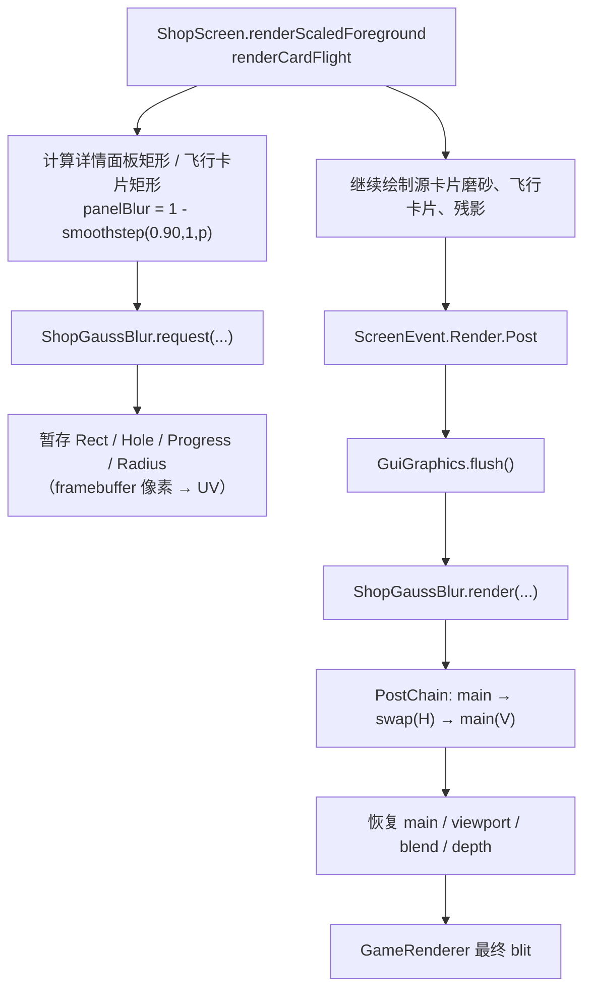
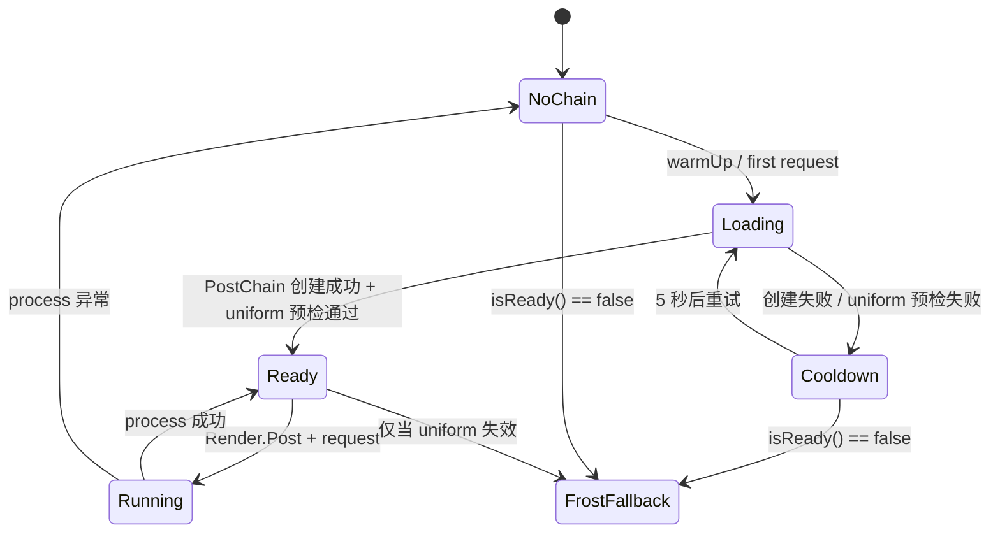

# 商店局部高斯模糊 技术实现

> 本文描述商店主界面在「商品卡片 → 右侧详情面板」飞行动画期间，对右侧商品面板做**局部高斯模糊**的完整实现。
>
> 实现位置：工作树 `.worktrees/shop-fluid-ui/`
>
> 对应代码：
> - `src/main/java/com/dishanhai/gt_shanhai/client/gui/shop/ShopGaussBlur.java`
> - `src/main/java/com/dishanhai/gt_shanhai/client/gui/shop/ShopScreen.java`
> - `src/main/java/com/dishanhai/gt_shanhai/client/ClientInit.java`
> - `src/main/resources/assets/gt_shanhai/shaders/program/shop_gauss_blur.{vsh,fsh,json}`
> - `src/main/resources/assets/gt_shanhai/shaders/post/shop_gauss_blur.json`
>
> 配套分析：`docs/blur-forge-高斯模糊技术分析-2026-10-19.md`

| 项目 | 内容 |
|---|---|
| 目标环境 | Minecraft 1.20.1 / Forge 47.4.16 / 客户端 |
| 模糊对象 | 商店右侧商品详情面板（GUI 本身，不是世界背景） |
| 实现方式 | 原版 `PostChain` + 2 趟可分离高斯 + `Rect`/`Hole` 局部遮罩 |
| 触发时机 | 卡片飞行动画期间，`ScreenEvent.Render.Post` |
| 降级方案 | 着色器加载/执行失败时回退为右侧面板局部磨砂 |
| 关键约束 | 不修改 `Screen.renderBackground`、不做全屏压暗、不引入 Satin |

---

## 1. 需求与约束

### 1.1 视觉需求

1. 点击商品卡片后，卡片从网格位置放大并移动到右侧详情面板。
2. 卡片飞行期间，**右侧商品面板**本身要失焦（高斯模糊），而不是整个世界背景。
3. 正在飞行的卡片必须保持清晰，不能被后处理一起糊掉。
4. 卡片归位时模糊结束，详情面板恢复清晰。
5. 源卡片保留在网格原位，不用「抠掉卡片」的方式制造空区。
6. 模糊不能表现为全屏变黑/变白。

### 1.2 技术约束

- 1.20.1 Forge 的 GUI 绘制顺序是：**世界 → HUD → Screen**。
  - `RenderGuiEvent.Pre/Post` 是 **HUD** 事件，触发在 `Screen.render` **之前**。
  - 因此不能在 `RenderGuiEvent.Post` 里对商店界面做后处理，那时商店还没画进 `minecraft:main`。
- 商店使用 `ScaledScreen` 虚拟分辨率，坐标是虚拟 GUI 单位，需要换算到 framebuffer 像素。
- 不引入 Satin、不自带 mixin refmap；尽量只依赖原版 `PostChain`。
- 着色器失败必须能降级，不能崩游戏。

---

## 2. 方案取舍

### 2.1 参考实现对比

| 方案 | 趟数 | 核 | 可动画 | 成本 | 适用 |
|---|---:|---|---|---|---|
| 原版 `post/blur.json` | 2 | 盒式 | 否（Radius 写死） | 82 taps/px | 一次性静态虚化 |
| blur-forge 3.1.1 | 4 | 三角（2 轮盒式） | 是（Progress） | 68 taps/px @R=8 | 全屏淡入淡出 |
| 本项目旧 `shop_stage_blur` | 2 | 5-tap 固定高斯近似 | 否 | 10 taps/px | 低开销 |
| **本实现** | **2** | **9-tap 高斯（5 次双线性采样）** | **是（Progress + Rect + Hole）** | **约 10 taps/px（仅面板内）** | **局部、可动画、可挖洞** |

### 2.2 为什么不用 framebuffer 截图模糊

- 需要额外的 `RenderTarget`、将 GUI 先渲染到离屏纹理、再做多趟后处理、最后合成，状态管理复杂。
- 商店是 GT 整合包里高频打开的界面，额外 RT 的显存和带宽不划算。
- 原版 `PostChain` 已经提供「main ↔ swap」的后处理链，直接在 `main` 上做局部采样更简单。

### 2.3 为什么不做全屏模糊

- 全屏后处理会把 HUD、聊天、其他界面一起糊掉。
- 用户明确要求模糊只局限在右侧商品面板。
- 本实现用 `Rect` 把片元处理限制在面板内，`Rect` 外每个 pass 只做一次原始采样。

### 2.4 为什么放在 `ScreenEvent.Render.Post`

```text
GameRenderer.render
  ├─ renderLevel(...)                 世界
  ├─ Gui.render(...)                  HUD
  │    ├─ RenderGuiEvent.Pre
  │    └─ RenderGuiEvent.Post         ← 此时 Screen 还没画，不能用
  ├─ ForgeHooksClient.drawScreen(...)
  │    ├─ ScreenEvent.Render.Pre
  │    ├─ ShopScreen.render(...)      商店界面（含飞行卡片）
  │    └─ ScreenEvent.Render.Post     ← 我们用这里
  ├─ GuiGraphics.flush()
  └─ mainRenderTarget.blitToScreen()
```

`ScreenEvent.Render.Post` 在 `Screen.render` 返回之后、最终 blit 之前触发，`minecraft:main` 里已经是完整的「世界 + HUD + 商店界面」。

---

## 3. 总体架构



职责划分：

| 模块 | 职责 |
|---|---|
| `ShopScreen` | 计算矩形、进度、半径；提交请求；绘制源卡片磨砂和飞行卡片 |
| `ShopGaussBlur` | 管理 `PostChain` 生命周期、uniform、状态恢复、失败降级 |
| 着色器 | 9-tap 高斯、`Rect`/`Hole` 遮罩、`Progress` 半径缩放 |
| `ClientInit` | 注册 `ScreenEvent.Render.Post` 监听器 |

---

## 4. 着色器实现

### 4.1 顶点着色器

`assets/gt_shanhai/shaders/program/shop_gauss_blur.vsh`

```glsl
#version 150

in vec4 Position;
uniform mat4 ProjMat;
uniform vec2 InSize;
uniform vec2 OutSize;

out vec2 texCoord;
out vec2 oneTexel;

void main() {
    vec4 outPos = ProjMat * vec4(Position.xy, 0.0, 1.0);
    gl_Position = vec4(outPos.xy, 0.2, 1.0);
    oneTexel = 1.0 / InSize;
    texCoord = Position.xy / OutSize;
}
```

要点：

- 自带 vsh，不依赖原版 `sobel.vsh`，避免资源包替换/移除导致链加载失败。
- `oneTexel = 1 / InSize` 是归一化 UV 的一像素步长。
- `texCoord` 与 `Position` 同一坐标系。

### 4.2 片元着色器

`assets/gt_shanhai/shaders/program/shop_gauss_blur.fsh`

```glsl
#version 150

uniform sampler2D DiffuseSampler;
uniform vec2 InSize;
uniform vec2 OutSize;
uniform vec2 BlurDir;
uniform float Radius;
uniform float Progress;
uniform vec4 Rect;   // xy = 左下角 UV，zw = 右上角 UV
uniform vec4 Hole;   // 正在飞行的卡片矩形，保持清晰

in vec2 texCoord;
in vec2 oneTexel;

out vec4 fragColor;

const float W0 = 0.227027;
const float W1 = 0.316216;
const float W2 = 0.070270;
const float O1 = 1.384615;
const float O2 = 3.230769;

void main() {
    vec2 uv = texCoord;

    bool insideRect = uv.x >= Rect.x && uv.x <= Rect.z
            && uv.y >= Rect.y && uv.y <= Rect.w;
    bool insideHole = Hole.z > Hole.x && Hole.w > Hole.y
            && uv.x >= Hole.x && uv.x <= Hole.z
            && uv.y >= Hole.y && uv.y <= Hole.w;

    if (!insideRect || insideHole) {
        fragColor = texture(DiffuseSampler, uv);
        return;
    }

    float radius = Radius * clamp(Progress, 0.0, 1.0);
    if (radius < 0.5) {
        fragColor = texture(DiffuseSampler, uv);
        return;
    }

    vec2 dir = BlurDir * oneTexel * radius;
    vec2 lo = Rect.xy;
    vec2 hi = Rect.zw;

    // 采样坐标夹在面板内部，避免把左侧网格/边框颜色吸进面板边缘
    vec4 sum = texture(DiffuseSampler, clamp(uv, lo, hi)) * W0;
    sum += texture(DiffuseSampler, clamp(uv + dir * O1, lo, hi)) * W1;
    sum += texture(DiffuseSampler, clamp(uv - dir * O1, lo, hi)) * W1;
    sum += texture(DiffuseSampler, clamp(uv + dir * O2, lo, hi)) * W2;
    sum += texture(DiffuseSampler, clamp(uv - dir * O2, lo, hi)) * W2;

    fragColor = vec4(sum.rgb, 1.0);
}
```

### 4.3 高斯核

采用标准 9-tap 高斯（σ≈2.0）的 5 次双线性采样近似：

| 偏移 | 权重 |
|---:|---:|
| 0 | 0.227027 |
| ±1.384615 | 0.316216 |
| ±3.230769 | 0.070270 |

权重和 ≈ 1.0。每次 pass 只做 5 次纹理采样；H/V 两趟合计 10 次。

`Radius` 是物理像素半径，`Progress` 是 0..1 的动画进度：

```text
实际半径 = Radius × Progress
```

- `Progress = 1`：完整模糊。
- `Progress = 0`：`radius < 0.5`，直接透传原图。
- 半径随进度收缩，避免「模糊强度硬切」。

### 4.4 为什么采样要 `clamp` 到 `Rect`

如果让采样点自由越过面板边界，左侧网格、面板边框的颜色会被吸进面板边缘，形成一圈「脏边」。

`clamp(uv ± offset, Rect.xy, Rect.zw)` 的效果是：

- 面板内部正常做高斯加权；
- 面板边缘重复边缘像素，相当于「边缘扩展」；
- 面板外完全不参与模糊。

### 4.5 程序描述

`assets/gt_shanhai/shaders/program/shop_gauss_blur.json`

```json
{
  "blend": {"func": "add", "srcrgb": "one", "dstrgb": "zero"},
  "vertex": "gt_shanhai:shop_gauss_blur",
  "fragment": "gt_shanhai:shop_gauss_blur",
  "attributes": ["Position"],
  "samplers": [{"name": "DiffuseSampler"}],
  "uniforms": [
    {"name": "ProjMat", "type": "matrix4x4", "count": 16, "values": [1,0,0,0, 0,1,0,0, 0,0,1,0, 0,0,0,1]},
    {"name": "InSize", "type": "float", "count": 2, "values": [1,1]},
    {"name": "OutSize", "type": "float", "count": 2, "values": [1,1]},
    {"name": "BlurDir", "type": "float", "count": 2, "values": [1,0]},
    {"name": "Radius", "type": "float", "count": 1, "values": [5.0]},
    {"name": "Progress", "type": "float", "count": 1, "values": [1.0]},
    {"name": "Rect", "type": "float", "count": 4, "values": [0,0,1,1]},
    {"name": "Hole", "type": "float", "count": 4, "values": [0,0,0,0]}
  ]
}
```

注意：

- `Rect`/`Hole` 是 `vec4`，在 JSON 里写成 `type: float, count: 4`。
- `Progress`/`Radius` 是动态 uniform，JSON 里的值是默认值，运行时覆盖。
- `ProjMat`/`InSize`/`OutSize` 由 `PostPass` 自动写入。
- 没有声明 `Time`/`ScreenSize` 也没关系：`EffectInstance#getUniform` 对缺失名字返回 dummy uniform。

### 4.6 后处理链

`assets/gt_shanhai/shaders/post/shop_gauss_blur.json`

```json
{
  "targets": ["swap"],
  "passes": [
    {
      "name": "gt_shanhai:shop_gauss_blur",
      "intarget": "minecraft:main",
      "outtarget": "swap",
      "uniforms": [
        {"name": "BlurDir", "values": [1.0, 0.0]},
        {"name": "Radius", "values": [5.0]}
      ]
    },
    {
      "name": "gt_shanhai:shop_gauss_blur",
      "intarget": "swap",
      "outtarget": "minecraft:main",
      "uniforms": [
        {"name": "BlurDir", "values": [0.0, 1.0]},
        {"name": "Radius", "values": [5.0]}
      ]
    }
  ]
}
```

- 第一趟 H：`main → swap`。
- 第二趟 V：`swap → main`。
- 最后一趟必须落回 `minecraft:main`，否则最终 blit 看到的不是模糊结果。
- `targets: ["swap"]` 由 `PostChain` 自动分配一张与主目标同尺寸的离屏缓冲。

### 4.7 UV 方向

`PostChain` 的投影是：

```java
new Matrix4f().setOrtho(0, mainWidth, 0, mainHeight, 0.1f, 1000.0f);
```

即 **左下角为 (0,0)**，`v=0` 对应画面底部。GUI 坐标是左上原点，所以：

```text
u0 = x / fbW
u1 = (x + w) / fbW
v0 = 1 - (y + h) / fbH
v1 = 1 - y / fbH
```

这段换算集中在 `ShopGaussBlur.toUvRect(...)`，并有单元测试覆盖。

---

## 5. Java 侧：`ShopGaussBlur`

### 5.1 状态字段

```java
private static PostChain chain;
private static int chainWidth = -1;
private static int chainHeight = -1;
private static boolean failed;
private static long failedAtMs;
private static boolean reflectionWarned;
private static boolean uniformFailed;

private static boolean requested;
private static float requestStrength;
private static float requestRadius = BLUR_RADIUS_VIRTUAL;
private static float[] requestRect;
private static float[] requestHole;
```

- `chain`：缓存的 `PostChain`，商店打开期间复用。
- `chainWidth/Height`：用于检测分辨率变化并 `resize`。
- `failed/failedAtMs`：加载失败后的 5 秒重试节流。
- `uniformFailed`：动态 uniform 预检失败标记。
- `requested/...`：本帧的模糊请求，帧末消费。

### 5.2 生命周期

```text
ShopScreen.initScaled()
  └─ ShopGaussBlur.warmUp()
       ├─ ensureChain()            创建/复用 PostChain
       └─ applyUniforms()          预检 Rect/Hole/Progress 是否存在

ShopScreen.renderScaledForeground()
  └─ renderCardFlight()
       └─ ShopGaussBlur.request(...)   记录本帧请求

ScreenEvent.Render.Post
  └─ ShopGaussBlur.onScreenRenderPost()
       ├─ 取出并清空请求
       ├─ GuiGraphics.flush()          提交本帧屏幕绘制
       └─ render()
            ├─ PostChain.process()
            ├─ 恢复 main / viewport / blend / depth
            └─ 最终由 GameRenderer blit
```

### 5.3 `warmUp()`

```java
public static void warmUp() {
    uniformFailed = false;
    PostChain post = ensureChain(Minecraft.getInstance());
    if (post != null) {
        try {
            uniformFailed = !applyUniforms(post, 1f, BLUR_RADIUS_VIRTUAL,
                    new float[]{0f, 0f, 1f, 1f}, new float[]{0f, 0f, 0f, 0f});
        } catch (Exception e) {
            uniformFailed = true;
            GTDishanhaiMod.LOGGER.error("商店高斯模糊 uniform 预检失败，已回退为局部磨砂", e);
        }
    }
}
```

目的：

- 在商店打开时编译/创建 `PostChain`，避免第一次点商品时才编译 shader 造成卡顿。
- 提前验证动态 uniform 是否存在，避免 `isReady()` 在第一帧误报可用。
- 预检失败时直接进入磨砂兜底。

### 5.4 `request()` / `clear()`

```java
public static void request(int x, int y, int w, int h, float strength,
                           float radiusPixels,
                           int holeX, int holeY, int holeW, int holeH) {
    if (strength <= 0.01f || w <= 0 || h <= 0) {
        clear();
        return;
    }
    Minecraft mc = Minecraft.getInstance();
    if (mc.getMainRenderTarget() == null) return;
    int fbW = mc.getMainRenderTarget().width;
    int fbH = mc.getMainRenderTarget().height;
    requestRect = toUvRect(x, y, w, h, fbW, fbH);
    requestHole = holeW > 0 && holeH > 0
            ? toUvRect(holeX, holeY, holeW, holeH, fbW, fbH)
            : new float[]{0f, 0f, 0f, 0f};
    requestStrength = clamp01(strength);
    requestRadius = radiusPixels > 0f ? radiusPixels : BLUR_RADIUS_VIRTUAL;
    requested = true;
}
```

- 坐标全部是 **framebuffer 像素，左上原点**。
- 请求只暂存，不立即渲染；真正的后处理在 `ScreenEvent.Render.Post`。
- `strength <= 0.01`、宽高非法时直接 `clear()`。
- `clear()` 在关闭商店、取消选中、飞行结束、屏幕关闭时调用，避免残留请求。

### 5.5 `toUvRect()`

```java
static float[] toUvRect(int x, int y, int w, int h, int fbW, int fbH) {
    if (fbW <= 0 || fbH <= 0 || w <= 0 || h <= 0) {
        return new float[]{0f, 0f, 0f, 0f};
    }
    float u0 = clamp01((float) x / (float) fbW);
    float u1 = clamp01((float) (x + w) / (float) fbW);
    float v0 = clamp01(1.0f - (float) (y + h) / (float) fbH);
    float v1 = clamp01(1.0f - (float) y / (float) fbH);
    return new float[]{u0, v0, u1, v1};
}
```

- 返回值顺序与 shader 的 `Rect.xy = 左下`、`Rect.zw = 右上` 一致。
- 对越界矩形做 `clamp01`，避免 UV 超出 [0,1]。

### 5.6 `onScreenRenderPost()`

```java
public static void onScreenRenderPost(ScreenEvent.Render.Post event) {
    boolean hadRequest = requested;
    float strength = requestStrength;
    float radius = requestRadius;
    float[] rect = requestRect;
    float[] hole = requestHole;
    clear();

    if (!hadRequest || rect == null || strength <= 0.01f) return;
    if (!(event.getScreen() instanceof ShopScreen)) return;
    if (event.getGuiGraphics() != null) {
        event.getGuiGraphics().flush();
    }
    render(Minecraft.getInstance(), strength, radius, rect,
            hole == null ? new float[]{0f, 0f, 0f, 0f} : hole, event.getPartialTick());
}
```

关键点：

1. **先消费请求再渲染**：即使渲染失败，本帧请求也不会残留到下一帧。
2. **只处理 `ShopScreen`**：其他界面即使有残留请求也不会被模糊。
3. **先 `flush()`**：`GuiGraphics` 里可能还有飞行卡片/源卡片磨砂的最后一批 quad；不 flush 就做后处理，会读到不完整的画面。
4. `event.getPartialTick()` 传给 `PostChain.process`。

### 5.7 `render()`

```java
private static void render(Minecraft mc, float strength, float radius,
                           float[] rect, float[] hole, float partialTick) {
    PostChain post = ensureChain(mc);
    if (post == null) return;
    if (mc.getMainRenderTarget() == null) return;

    int fbW = mc.getMainRenderTarget().width;
    int fbH = mc.getMainRenderTarget().height;
    if (fbW != chainWidth || fbH != chainHeight) {
        post.resize(fbW, fbH);
        chainWidth = fbW;
        chainHeight = fbH;
    }
    if (!applyUniforms(post, strength, radius, rect, hole)) {
        uniformFailed = true;
        return;
    }
    uniformFailed = false;

    RenderSystem.disableBlend();
    RenderSystem.disableDepthTest();
    RenderSystem.depthMask(false);
    try {
        post.process(partialTick);
        failed = false;
    } catch (Exception e) {
        chain = null;
        failed = true;
        failedAtMs = System.currentTimeMillis();
        GTDishanhaiMod.LOGGER.error("商店高斯模糊执行失败，已回退为局部磨砂", e);
    } finally {
        if (mc.getMainRenderTarget() != null) {
            mc.getMainRenderTarget().bindWrite(false);
            RenderSystem.viewport(0, 0, fbW, fbH);
        }
        RenderSystem.depthMask(true);
        RenderSystem.enableDepthTest();
        RenderSystem.enableBlend();
        RenderSystem.defaultBlendFunc();
        RenderSystem.colorMask(true, true, true, true);
        RenderSystem.setShaderColor(1f, 1f, 1f, 1f);
    }
}
```

状态恢复的原因：

- `PostPass#process` 会 `disableBlend` / `disableDepthTest` / `depthMask(false)`。
- 每个 pass 结束后 `outTarget.unbindWrite()` 会把默认 framebuffer 设回来。
- 后续 `GameRenderer` 还要 flush toast、tile、tooltip 等，必须把 `main` 重新绑回去。
- 恢复 `viewport`、blend、depth、colorMask、shaderColor，避免污染后续 GUI 绘制。

### 5.8 `applyUniforms()`

```java
private static boolean applyUniforms(PostChain post, float strength, float radius,
                                     float[] rect, float[] hole) {
    List<PostPass> passes = passesOf(post);
    if (passes.isEmpty()) return false;
    boolean allReady = true;
    for (PostPass pass : passes) {
        Uniform rectUniform = pass.getEffect().getUniform("Rect");
        Uniform holeUniform = pass.getEffect().getUniform("Hole");
        Uniform progressUniform = pass.getEffect().getUniform("Progress");
        if (rectUniform == null || holeUniform == null || progressUniform == null) {
            allReady = false;
            continue;
        }
        rectUniform.set(rect[0], rect[1], rect[2], rect[3]);
        holeUniform.set(hole[0], hole[1], hole[2], hole[3]);
        progressUniform.set(strength);
        Uniform radiusUniform = pass.getEffect().getUniform("Radius");
        if (radiusUniform != null) {
            radiusUniform.set(radius);
        }
    }
    return allReady;
}
```

**安全阀**：只要任意一个 pass 缺少 `Rect`/`Hole`/`Progress`，就返回 `false`，整个后处理跳过。

为什么必须这样：

- 程序 JSON 里 `Rect` 的默认值是 `(0,0,1,1)`，也就是全屏。
- 如果 uniform 没设置成功却仍然执行 `post.process`，就会变成**全屏模糊**。
- 宁可回退到局部磨砂，也不能让 `Rect` 落回默认全屏值。

### 5.9 `PostChain.passes` 反射

```java
private static final Field POST_CHAIN_PASSES = resolvePassesField();

private static Field resolvePassesField() {
    for (String name : new String[]{"passes", "f_110009_"}) {
        try {
            Field field = PostChain.class.getDeclaredField(name);
            field.setAccessible(true);
            return field;
        } catch (NoSuchFieldException | RuntimeException ignored) {
            // 开发环境 / 生产环境字段名不同，或反射被限制；继续试下一个。
        }
    }
    return null;
}
```

原因：

- `PostChain#passes` 是私有字段。
- 项目没有 mixin refmap；开发环境字段名是 `passes`，生产环境是 SRG 的 `f_110009_`。
- 按两个名字依次解析，避免额外引入 `@Accessor` mixin 和 refmap 维护成本。
- 解析失败时 `POST_CHAIN_PASSES == null`，`passesOf` 返回空列表，`applyUniforms` 返回 `false`，自动走磨砂兜底。

### 5.10 `ensureChain()` / `resize` / 重试

```java
private static PostChain ensureChain(Minecraft mc) {
    if (chain != null) return chain;
    if (mc.getMainRenderTarget() == null) return null;
    long now = System.currentTimeMillis();
    if (failed && now - failedAtMs < RETRY_MS) return null;
    try {
        int fbW = mc.getMainRenderTarget().width;
        int fbH = mc.getMainRenderTarget().height;
        PostChain created = new PostChain(
                mc.getTextureManager(),
                mc.getResourceManager(),
                mc.getMainRenderTarget(),
                new ResourceLocation(GTDishanhaiMod.MOD_ID, "shaders/post/shop_gauss_blur.json"));
        created.resize(fbW, fbH);
        chain = created;
        chainWidth = fbW;
        chainHeight = fbH;
        failed = false;
        uniformFailed = false;
        return chain;
    } catch (Exception e) {
        failed = true;
        failedAtMs = now;
        GTDishanhaiMod.LOGGER.error("商店高斯模糊加载失败，已回退为局部磨砂", e);
        return null;
    }
}
```

- `PostChain` 只在第一次打开商店时创建，之后复用。
- 分辨率变化时在 `render()` 里 `post.resize(fbW, fbH)`，并重新下发 uniform。
- 加载失败后 5 秒内不重复尝试，避免每帧刷日志。

---

## 6. 商店侧接入

### 6.1 飞行几何与进度

`ShopScreen#beginCardFlight(...)`：

```java
this.cardFlightDstX = detailX();
this.cardFlightDstY = contentTop();
this.cardFlightDstW = DETAIL_W;
this.cardFlightDstH = contentHeight();

double dx = (dstX + dstW / 2.0) - (srcX + srcW / 2.0);
double dy = (dstY + dstH / 2.0) - (srcY + srcH / 2.0);
double response = GuiRenderUtil.flightResponseForDistance(Math.hypot(dx, dy));
this.cardFlightSpring.start(System.currentTimeMillis(), response);
```

- 位置和尺寸走同一条几何通道：`flightValue(src, dst, p)`。
- 卡片离详情面板越远，弹簧 `response` 越大：
  - 最近 `0.16s`
  - 800 逻辑像素及以上封顶 `0.32s`
  - 中间线性过渡
- 弹簧参数 `dampingFraction = 0.92`，接近临界阻尼，落位时几乎不超调。

### 6.2 模糊请求

`ShopScreen#renderCardFlight(...)`：

```java
float panelBlur = 1f - smoothstep(0.90f, 1f, p);
if (panelBlur > 0.01f) {
    int detailLeft = detailX();
    int detailTop = contentTop();
    int detailW = DETAIL_W;
    int detailH = contentHeight();

    float pixelScale = (float) this.minecraft.getMainRenderTarget().width
            / (float) this.width;
    float radiusPx = ShopGaussBlur.BLUR_RADIUS_VIRTUAL * this.guiScale * pixelScale;

    ShopGaussBlur.request(
            toFramebufferX(detailLeft), toFramebufferY(detailTop),
            toFramebufferW(detailW), toFramebufferH(detailH),
            panelBlur, radiusPx,
            toFramebufferX(rx - 2), toFramebufferY(ry - 2),
            toFramebufferW(rw + 4), toFramebufferH(rh + 4));

    if (!ShopGaussBlur.isReady()) {
        int frostA = (int) (0x3A * panelBlur);
        int frostB = (int) (0x1C * panelBlur);
        g.fill(detailLeft, detailTop, detailLeft + detailW, detailTop + detailH,
                (frostA << 24) | 0x8E98A4);
        g.fill(detailLeft, detailTop, detailLeft + detailW, detailTop + detailH,
                (frostB << 24) | 0xB4BEC8);
    }
} else {
    ShopGaussBlur.clear();
}
```

参数说明：

| 参数 | 含义 |
|---|---|
| `detailLeft/Top/W/H` | 右侧详情面板矩形（虚拟坐标） |
| `panelBlur` | `1 - smoothstep(0.90, 1, p)`，卡片归位时归零 |
| `radiusPx` | `5 虚拟单位 × 虚拟→GUI 比例 × GUI→物理像素比例` |
| `rx/ry/rw/rh` | 当前飞行卡片矩形 |
| `rx-2 / ry-2 / rw+4 / rh+4` | 挖洞矩形，外扩 2 虚拟单位，避免卡片边缘被糊 |

### 6.3 坐标换算

`ShopScreen` 使用 `ScaledScreen` 虚拟分辨率：

```java
private int toFramebufferX(float virtualX) {
    int fbW = this.minecraft.getMainRenderTarget().width;
    float screenX = this.offsetX + virtualX * this.guiScale;
    return (int) Math.round((double) screenX * fbW / (double) this.width);
}

private int toFramebufferY(float virtualY) {
    int fbH = this.minecraft.getMainRenderTarget().height;
    float screenY = this.offsetY + virtualY * this.guiScale;
    return (int) Math.round((double) screenY * fbH / (double) this.height);
}

private int toFramebufferW(float virtualWidth) {
    int fbW = this.minecraft.getMainRenderTarget().width;
    return Math.max(1, (int) Math.round((double) virtualWidth * this.guiScale
            * fbW / (double) this.width));
}

private int toFramebufferH(float virtualHeight) {
    int fbH = this.minecraft.getMainRenderTarget().height;
    return Math.max(1, (int) Math.round((double) virtualHeight * this.guiScale
            * fbH / (double) this.height));
}
```

为什么不用 `window.getGuiScale()`：

- `ScaledScreen` 先把虚拟画布缩放到 `Screen.width/height`，Minecraft 再把 `Screen.width/height` 缩放到 framebuffer。
- `mainTarget.width / Screen.width` 直接给出「GUI 单位 → framebuffer 像素」的比例，包含窗口 GUI scale 和可能的渲染目标缩放。
- 这样在 1080p/2K/4K、不同 GUI scale 下，模糊半径和矩形位置都一致。

### 6.4 源卡片不抠掉

`ShopScreen#drawSourceCardBlur(...)`：

- 源卡片继续在网格原位绘制。
- 在卡片矩形上叠两层浅色磨砂：
  - `0x88C6D0DA`
  - `0x50D8E2EA`
- 图标在 6 个偏移位置以低透明度重绘，模拟模糊拖影。
- 外圈加两层柔光轮廓，让卡片边界化开。
- 这是纯 `g.fill` + 重绘，不采样 framebuffer，不影响邻居布局。

注意：这是源卡片的**局部 fake blur**；右侧详情面板才是真正的 `PostChain` 高斯模糊。

### 6.5 飞行卡片的清晰保护

- `Hole` 是当前飞行卡片矩形，外扩 2 虚拟单位。
- shader 在 `Hole` 内直接 `fragColor = texture(DiffuseSampler, uv)`，不参与模糊。
- 因此卡片在进入详情面板区域后仍然清晰，直到它自己淡出。

### 6.6 清理点

`ShopGaussBlur.clear()` 在这些位置调用：

- `ShopScreen.initScaled` 不调用（只 `warmUp`）。
- `renderCardFlight` 弹簧归位时。
- `renderCardFlight` `fade <= 0.01` 时。
- `panelBlur <= 0.01` 时。
- `selectEntry` 取消旧飞行时。
- `clearSelection` 时。
- `onClose` / `removed` 时。

---

## 7. 参数与调优

| 参数 | 位置 | 默认值 | 说明 |
|---|---|---:|---|
| `BLUR_RADIUS_VIRTUAL` | `ShopGaussBlur` | `5.0` | 虚拟 GUI 单位；越大越糊 |
| `smoothstep(0.90, 1, p)` | `ShopScreen` | `0.90` | 模糊淡出窗口；越接近 1 越晚淡出 |
| `smoothstep(0.93, 1, p)` | `ShopScreen` | `0.93` | 飞行层淡出窗口 |
| `Hole` 外扩 | `ShopScreen` | `2` 虚拟单位 | 越大卡片保护范围越大，周围糊得越少 |
| 磨砂兜底色 | `ShopScreen` | `0x3A8E98A4` + `0x1CB4BEC8` | 只在后处理不可用时使用 |
| `RETRY_MS` | `ShopGaussBlur` | `5000` | 加载失败后的重试间隔 |
| `RADIUS` 权重 | shader | 0.227/0.316/0.070 | 9-tap 高斯标准权重 |

调参建议：

- **觉得不够糊**：提高 `BLUR_RADIUS_VIRTUAL`（例如 6~8），不要提高 `Progress` 权重（没有权重）。
- **觉得糊得过头**：降到 3~4。
- **觉得模糊结束太早**：把 `smoothstep(0.90, 1, p)` 的 0.90 改成 0.94。
- **觉得卡片边缘有糊边**：把 `Hole` 外扩从 2 改成 3~4。
- **低端显卡掉帧**：降低 `BLUR_RADIUS_VIRTUAL`、把 shader 的 5 次采样改成 3 次（中心 + 一对），或只在 `panelBlur > 0.5` 时执行。

---

## 8. 性能

### 8.1 采样量

| 区域 | H 趟 | V 趟 | 合计 |
|---|---:|---:|---:|
| `Rect` 外 | 1 次原始采样 | 1 次原始采样 | 2 taps/px |
| `Rect` 内、`Hole` 外 | 5 次 | 5 次 | 10 taps/px |
| `Hole` 内 | 1 次 | 1 次 | 2 taps/px |

- 右侧详情面板宽 `DETAIL_W = 158` 虚拟单位；在 1080p、GUI scale 2~3 下，物理尺寸大约 300~500 px 宽。
- 面板内约 24 万~40 万像素；10 taps/px ≈ 240 万~400 万次采样/帧。
- 只在卡片飞行期间（约 0.25~0.5 秒）执行，不是常驻全屏后处理。

### 8.2 显存

- `PostChain` 的 `swap` 目标与主目标同尺寸（颜色缓冲 + 深度缓冲）：
  - 1080p 约 16 MB；
  - 1440p 约 28 MB；
  - 4K 约 64 MB。
- `PostChain` 在第一次打开商店时创建，之后复用；关闭商店不释放，避免重复编译 shader。

### 8.3 每帧 CPU

- 2 个 pass × 4 个动态 uniform 写入。
- 2 个 `float[4]` 矩形换算。
- 一次 `GuiGraphics.flush()`。
- 一次 `PostChain.process()`。
- 无逐像素 CPU 计算。

---

## 9. 失败路径与降级



| 失败点 | 行为 |
|---|---|
| `PostChain` 构造失败 | 记录日志，5 秒内不重试，`isReady()` 为 false |
| shader 编译失败 | 同上 |
| `Rect`/`Hole`/`Progress` 缺失 | `uniformFailed = true`，跳过 `process`，走磨砂 |
| `PostChain.passes` 反射失败 | `passesOf` 返回空，跳过 `process`，走磨砂 |
| `process` 运行时异常 | 捕获，`chain = null`，下一帧走磨砂 |
| 主目标为空 | 直接返回，不崩 |
| 商店关闭/取消选中 | `clear()`，不残留请求 |

**磨砂兜底**只在右侧详情面板上叠两层浅色，不会全屏刷白/黑屏。

---

## 10. 测试

### 10.1 单元测试

`src/test/java/com/dishanhai/gt_shanhai/client/gui/shop/ShopGaussBlurUvTest.java`

覆盖：

- 左上原点像素矩形 → 左下原点 shader UV 的 Y 翻转。
- 越界矩形的 `clamp`。
- 退化输入（宽/高为 0、framebuffer 尺寸为 0）。

示例：

```java
float[] uv = ShopGaussBlur.toUvRect(10, 20, 30, 40, 100, 200);
assertArrayEquals(new float[]{0.10f, 0.70f, 0.40f, 0.90f}, uv, 1e-6f);
```

### 10.2 源码约束测试

`ShopGaussBlurSourceTest`：

- 4 个 shader 资源存在。
- `ShopScreen` 调用了 `ShopGaussBlur.request` / `clear`。
- 不再有整块面板的 `left + 6, top + 6, left + panelWidth - 6` 磨砂。
- `ShopGaussBlur` 使用 `PostChain`、`f_110009_`、`ScreenEvent.Render.Post`。
- `ClientInit` 注册 `ShopGaussBlur::onScreenRenderPost`。
- shader 包含 `Rect`/`Hole`/`Progress`。
- post JSON 包含两趟 `BlurDir`。

`ShopFluidMotionSourceTest`：

- 飞行仍然是一条几何通道 + 源卡磨砂/残影。
- 没有重新引入 `cardFlightEntryKey`、`new RenderTarget`。

### 10.3 验证命令

```powershell
.\gradle-install\gradle-8.8\bin\gradle.bat test `
  --tests "com.dishanhai.gt_shanhai.client.gui.shop.*" `
  --tests "com.dishanhai.gt_shanhai.client.gui.scaled.*" `
  --no-daemon --offline
```

构建：

```powershell
.\gradle-install\gradle-8.8\bin\gradle.bat build -x test --no-daemon --offline
```

产物：

```text
build/libs/gt_shanhai.jar
```

> 完整 `test` 任务仍有历史存量失败（配方/网络/终端相关），与本次 UI 改动无关；本次只运行商店/缩放 UI 相关测试，构建使用 `-x test`。

---

## 11. 已知限制

1. **不是任意半径的严格高斯**：9-tap 近似 + 线性半径缩放，视觉上足够，但不是数学上的连续高斯。
2. **`Hole` 是矩形**：飞行卡片四角如果是圆角，矩形挖洞会在四角留下极小的清晰/模糊交界；影响很小。
3. **只对 `ShopScreen` 生效**：`onScreenRenderPost` 里检查 `instanceof ShopScreen`，其他商店子界面不会自动模糊。
4. **源卡片是 fake blur**：`drawSourceCardBlur` 用磨砂 + 偏移重绘，不采样 framebuffer；只有右侧详情面板是真高斯。
5. **资源重载**：`PostChain` 缓存在静态字段里；F3+T 后不会主动重建。mod 自带 shader 不受资源包影响；如果确实替换了 shader，需要重启客户端，或等一次 `process` 异常把 `chain` 置空后走 5 秒重试。
6. **PostChain 常驻**：关闭商店不释放 `swap` 目标，约 8~32 MB 显存；换取重复打开商店不重新编译 shader。
7. **完整测试未跑**：如上，存量失败与本次无关。

---

## 12. 文件索引

| 文件 | 作用 |
|---|---|
| `client/gui/shop/ShopGaussBlur.java` | 后处理链、uniform、状态恢复、降级 |
| `client/gui/shop/ShopScreen.java` | 飞行几何、请求、坐标换算、源卡磨砂、兜底 |
| `client/ClientInit.java` | 注册 `ScreenEvent.Render.Post` |
| `assets/gt_shanhai/shaders/program/shop_gauss_blur.vsh` | 后处理顶点着色器 |
| `assets/gt_shanhai/shaders/program/shop_gauss_blur.fsh` | 9-tap 高斯 + 局部遮罩 |
| `assets/gt_shanhai/shaders/program/shop_gauss_blur.json` | 程序描述 |
| `assets/gt_shanhai/shaders/post/shop_gauss_blur.json` | H/V 两趟后处理链 |
| `test/.../ShopGaussBlurUvTest.java` | UV 换算测试 |
| `test/.../ShopGaussBlurSourceTest.java` | 资源/接线约束测试 |
| `test/.../ShopFluidMotionSourceTest.java` | 飞行层回归测试 |

### 关键方法

| 方法 | 位置 | 说明 |
|---|---|---|
| `ShopGaussBlur.warmUp()` | `ShopGaussBlur.java` | 商店打开时预编译 + uniform 预检 |
| `ShopGaussBlur.request(...)` | `ShopGaussBlur.java` | 记录本帧矩形/进度/半径 |
| `ShopGaussBlur.onScreenRenderPost(...)` | `ShopGaussBlur.java` | 帧末执行入口 |
| `ShopGaussBlur.render(...)` | `ShopGaussBlur.java` | 状态保存、`PostChain.process`、状态恢复 |
| `ShopGaussBlur.applyUniforms(...)` | `ShopGaussBlur.java` | 写入 `Rect`/`Hole`/`Progress`/`Radius` |
| `ShopGaussBlur.toUvRect(...)` | `ShopGaussBlur.java` | 像素矩形 → 左下原点 UV |
| `ShopScreen.renderCardFlight(...)` | `ShopScreen.java` | 飞行绘制 + 模糊请求 |
| `ShopScreen.toFramebufferX/Y/W/H(...)` | `ShopScreen.java` | 虚拟坐标 → framebuffer 像素 |
| `ShopScreen.drawSourceCardBlur(...)` | `ShopScreen.java` | 源卡片局部磨砂 |
| `GuiRenderUtil.flightResponseForDistance(...)` | `GuiRenderUtil.java` | 距离 → 弹簧 response |

---

## 13. 参考

- `docs/blur-forge-高斯模糊技术分析-2026-10-19.md`
- 原版 `assets/minecraft/shaders/post/blur.json`
- 原版 `assets/minecraft/shaders/program/blur.fsh`
- 原版 `assets/minecraft/shaders/program/sobel.vsh`
- Forge 1.20.1 `ScreenEvent.Render.Post`
- 原版 `net.minecraft.client.renderer.PostChain` / `PostPass` / `EffectInstance`
