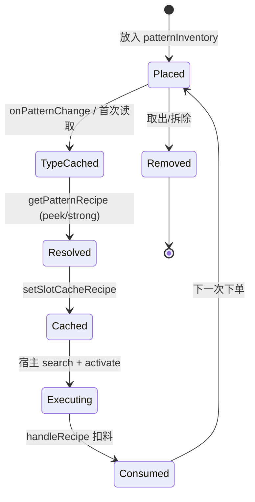

# 星律样板总成 技术细节

> 本文描述 `gt_shanhai:recipe_type_pattern_buffer`（星律样板总成）的实现机制、数据结构、执行链、持久化与配置边界。
>
> 对应代码：`src/main/java/com/dishanhai/gt_shanhai/common/machine/part/RecipeTypePatternBufferPartMachine.java`（3349 行）及其基类、helper、mixin。
>
> 配套审计报告：`docs/星律样板总成_代码审计报告.md`。

---

## 1. 定位与注册

### 1.1 方块注册

`DShanhaiMachines.java:1453-1474`：

```java
RECIPE_TYPE_PATTERN_BUFFER = MachineBuilder.create(
        GTDishanhaiRegistration.REGISTRATE,
        "recipe_type_pattern_buffer",
        MachineDefinition::createDefinition,
        holder -> new RecipeTypePatternBufferPartMachine(holder,
                DShanhaiConfig.COMMON.recipeTypePatternsPerRow.get(),
                DShanhaiConfig.COMMON.recipeTypeRowsPerPage.get(),
                DShanhaiConfig.COMMON.recipeTypeMaxPages.get(),
                DShanhaiConfig.COMMON.recipeTypeWildcardSlotsPerPage.get(),
                DShanhaiConfig.COMMON.recipeTypeWildcardMaxPages.get()),
        MetaMachineBlock::new,
        MetaMachineItem::new,
        MetaMachineBlockEntity::createBlockEntity
)
.rotationState(RotationState.ALL)
.abilities(PartAbility.IMPORT_ITEMS, PartAbility.IMPORT_FLUIDS,
        PartAbility.EXPORT_ITEMS, PartAbility.EXPORT_FLUIDS)
.renderer(...)
.register();
```

要点：

- 以**仓室零件**（part）形式接入多方块，不是独立机器。
- 能力声明为物品/流体双向（`IMPORT_*` + `EXPORT_*`），因此宿主只要支持 ME 样板缓冲仓即可接入。
- 方块 ID `gt_shanhai:recipe_type_pattern_buffer`，代理 ID `gt_shanhai:recipe_type_pattern_buffer_proxy`（`DShanhaiMachines.java:1503-1518`）。
- 渲染立方体贴图：`block/casings/recipe_type_pattern_buffer_casing` + `block/machine/part/recipe_type_pattern_buffer`。

### 1.2 类层次

```text
MEPatternBufferPartMachine (GTLCore)
  └ StellarSuperPatternBufferPartMachine
        implements IModifiableSyncOffset
        - 32+32 库存输入配置格
        - StockingPatternBufferInternalSlot
        - ExportOnlyAEStockingItemList / FluidList
    └ RecipeTypePatternBufferPartMachine
          implements RecipeTypePatternSlotAccess, ICraftingRequester
          - 配方类型绑定
          - 通配符母槽/展开槽
          - 产出倍率
          - 强匹配
          - 卡死告警
          - 远程 UI / 终端
```

`StellarSuperPatternBufferPartMachine` 的存在原因（类注释 `:57-63`）：EnhancedCore 2.9.x 的 IV 执行链以方块注册 ID 为入口，需要把 GTLCore 的库存输入功能放在**可继承的基类**上，让星律本体同时保留库存输入和 EnhancedCore 结构兼容。

### 1.3 代理

`RecipeTypePatternBufferProxyPartMachine.java:12-28`：

- 继承 `MEPatternBufferProxyPartMachine`。
- 重写 `setBuffer(BlockPos)`：只有目标位置是 `RecipeTypePatternBufferPartMachine` 时才允许绑定。
- 代理本身不存样板/库存，只是本体在结构其他位置的“影子接口”；绑定后宿主通过代理访问本体的槽位、缓存和 UI。

---

## 2. 槽位模型

星律有四类“槽”概念，必须区分：

| 概念 | 数量 | 全局索引 | 存储 | 是否参与 AE 样板列表 |
|---|---:|---|---|---|
| 普通样板槽 | `maxPatternCount = patternsPerRow × rowsPerPage × maxPages` | `0 .. maxPatternCount-1` | `patternInventory`（父类 `ItemStackTransfer`） | 是 |
| 通配符母槽 | `wildcardSlotCount = wildcardSlotsPerPage × wildcardMaxPages` | 不进入 InternalSlot 索引 | `wildcardPatternInventory` | 否（只作为展开源） |
| 通配展开槽 | 动态，等于展开去重后的样板数 | `maxPatternCount + i` | `wildcardInternalSlots` / `wildcardPatterns` / `wildcardPatternStacks` | 是 |
| 库存输入格 | 32 物品 + 32 流体 | 不进入样板索引 | `stockItemHandler` / `stockFluidHandler` | 否 |

### 2.1 普通样板槽

- `maxPatternCount` 由构造参数 `patternsPerRow * rowsPerPage * maxPages` 决定（`:291`）。
- 每个槽对应一个 `StellarPatternBufferInternalSlot`（`:370-385`）。
- `isItemActive/isFluidActive` 只检查 `hasPatternInSlot(slot)`，**不再因为槽内有残留原料而禁用槽位**。这是为了修复“残留库存导致槽位不活跃、后续不再匹配”的问题（测试 `RecipeTypePatternBufferResidualInputSourceTest`）。
- 槽位配方类型缓存：
  - `patternRecipeTypeIds[slot]`：类型 ID 字符串。
  - `patternRecipeTypeStackHashes[slot]`：对应 ItemStack 的 32 位哈希，用于判断是否需要重读 NBT。
  - `strictRecipeIdWarningStackHashes[slot]`：强匹配红框的栈哈希。
  - `strongMatchLogStamps[slot]`：强匹配日志去重戳。

### 2.2 通配符母槽

- 默认 `10 × 2 = 20` 格（`:149-152`）。
- `wildcardPatternInventory` 是 `ItemStackTransfer`，过滤器只接受：
  - GTLCore `wildcard_pattern` 模组的通配样板（通过 `WildcardPatternBridge` 反射识别）。
  - 山海自己的 `SelectedRecipePattern`（星律通配样板）。
- 母槽可以单独指定配方类型：
  - `assignWildcardRecipeType(slot, GTRecipeType)` 写入 `gt_shanhai_recipe_type`。
  - `clearWildcardRecipeType(slot)` 恢复“自动识别”。
- 每个母槽的展开预览单独保存在 `wildcardPreviewByMother`，切换母槽编号不会回到第一张。

### 2.3 通配展开槽

`refreshWildcardPatterns(boolean restorePersistedData)`（`:2358-2413`）负责生成：

1. 遍历所有母槽。
2. 若是 `SelectedRecipePattern`，调用 `SelectedRecipePattern.expand`，按记录的配方 ID 逐条展开。
3. 否则调用 `WildcardPatternBridge.expandPatterns`，由 GTLCore 通配符兼容层按材料条件展开。
4. 若母槽指定了类型，展开配方类型不匹配的直接丢弃。
5. `rememberWildcardPattern` 写入配方类型/ID、应用产出倍率、用 `serializeNBT()` 去重。
6. 去重后的每个样板生成一个 `InternalSlot`，全局索引 `maxPatternCount + localSlot`。
7. 填充：
   - `wildcardPatterns`：`IPatternDetails`
   - `wildcardPatternStacks`：展开后的样板物品
   - `wildcardResolvedRecipes`：解析出的 `GTRecipe`
   - `wildcardAssignedRecipeTypeIds`：母槽指定类型
   - `wildcardInternalSlots`：内部库存槽
   - `wildcardPatternToSlot`：`IPatternDetails -> globalSlot`
8. 若 `restorePersistedData=true`，从 `RecipeTypePatternWildcardPersistence` 恢复内部槽库存与配方缓存。

### 2.4 槽位数量接口

三个数量不要混淆：

| 方法 | 返回 | 用途 |
|---|---|---|
| `gtShanhai$getPatternSlotCount()`（`:1547-1550`） | `maxPatternCount + wildcardPatternStacks.size()` | 搜索/首配遍历“所有可执行样板槽” |
| `getInternalSlotCount()`（`:1653-1656`） | `maxPatternCount + wildcardInternalSlots.size()` | InternalSlot 访问边界 |
| `getTerminalPatternInventory().size()`（`:2280-2317`） | `normalInventory.size() + wildcardSlotCount` | 终端/UI 可读写的“母槽”视图，不是展开槽 |

`getInternalSlot(slot)`（`:1658-1666`）：

- `slot < maxPatternCount`：父类内部槽。
- 否则 `localSlot = slot - maxPatternCount`，取 `wildcardInternalSlots[localSlot]`。
- 越界抛 `IndexOutOfBoundsException("Wildcard pattern slot: ...")`。

---

## 3. 配方类型身份

### 3.1 NBT 键

| 键 | 常量 | 含义 |
|---|---|---|
| `gt_shanhai_recipe_type` | `PatternRecipeTypeHelper.TAG_RECIPE_TYPE` | 配方类型 ID，如 `gtceu:chemical_reactor` |
| `gt_shanhai_recipe_id` | `TAG_RECIPE_ID` | 精确配方 ID，如 `gtceu:chemical_reactor/xxx` |
| `gt_shanhai_recipe_type_authoritative` | `TAG_RECIPE_TYPE_AUTHORITATIVE` | 编码时零歧义来源，永久信任 |
| `gtlcore.patternQuickUploadRecipeTypes` | `GTLCORE_TAG` + `GTLCORE_QUICK_UPLOAD_TAG` | GTLCore 快速上传写入的类型列表 |

### 3.2 读取优先级

`readRecipeTypeId(stack)`（`:218-241`）：

1. 若 `authoritative=true` 且 `gt_shanhai_recipe_type` 非空 → 直接返回。
2. 否则读 `gtlcore.patternQuickUploadRecipeTypes`：
   - 列表去重后**恰好一个**元素才采信；多个候选视为歧义，返回空。
3. 否则读 `gt_shanhai_recipe_type`。
4. 都没有 → 空串。

为什么 GTLCore 字段优先：GTLCore 在编码那一刻知道确切来源配方；星律事后按输入/输出反查全配方表，在“不同类型恰好同输入输出”时会猜错（代码注释 `:228-232`）。

`readRecipeId(stack)`（`:64-74`）：

1. 读 `gt_shanhai_recipe_id`，能解析为 `ResourceLocation` 就返回。
2. 否则读 `SelectedRecipePattern.RECIPE_ID`（`gt_shanhai_bundle_recipe`）作为旧格式回退。
3. 否则空串。

`writeRecipeId` 受 `PatternEncodePreferences.writeRecipeId()` 控制；关闭后编码和快速上传都不写，但不会清掉旧 ID。

### 3.3 权威标记

`writeAuthoritativeRecipeType(stack, recipe)`（`:156-161`）会一次性写入：

- `gt_shanhai_recipe_type`
- `gt_shanhai_recipe_id`
- `gt_shanhai_recipe_type_authoritative=true`

之后：

- `ensureRecipeTypeId` / `ensureRecipe` / `peekRecipe` 都只在**该类型域内**解析，不再全局重推断/覆盖。
- 这样避免“某次瞬时失配触发自愈改判，导致两套类型来回横跳”。

`writeRecipeTypeFromPattern`（`:400-428`）的优先级：

1. 编码线程上下文里有权威配方 → 写权威。
2. 有 JEI 选中配方 → 重新验证后写权威。
3. 有编码类型 ID → 写该类型（权威）。
4. 否则按输入输出反查，写普通类型。

### 3.4 类型别名与规范化

`canonicalRecipeTypeId`（`:632-643`）：

| 输入 | 输出 |
|---|---|
| `minecraft:smelting` | `gtceu:electric_furnace` |
| `smelting` | `gtceu:electric_furnace` |
| `gtceu:matter_exoticizer` | `gtceu:matter_exotic` |
| 其他 | `trim().toLowerCase(Locale.ROOT)` |

`normalizeRecipeTypeId`（`:646-648`）：`null -> ""`，否则 `trim + toLowerCase`。

`areRecipeTypeIdsEquivalent`（`:624-630`）：先规范化比较，再规范化别名比较。

### 3.5 解析函数

| 函数 | 行为 | 是否写 NBT |
|---|---|---|
| `ensureRecipeTypeId` | 现有类型能匹配就保留；类型表未就绪不判负；否则全局推断并写入 | 是 |
| `ensureRecipe` | 同上，返回 `GTRecipe` | 是 |
| `peekRecipe` | 现有类型优先；失败回退全局；只读 | 否 |
| `peekRecipeTypeId` | `peekRecipe` 的类型版本；失败保留现有值 | 否 |
| `resolveRecipeForPattern` | 只在声明的类型域内按 ID 精确解析 | 否 |
| `resolveRecipe` | 全类型搜索，支持原版熔炼 | 否 |

星律运行时对普通槽使用 `peekRecipe`（`:963-971`），原因：样板同时在向 AE 网络供货，改 NBT 会改变 `AEItemKey` 身份。

### 3.6 精确 ID 策略

`PatternRecipeIdMatchPolicy.matches`（`:11-38`）：

1. 四个 ID 都能解析为 `ResourceLocation`。
2. 样板类型与候选类型的 **canonical** 值相等。
3. 样板 ID 和候选 ID 的路径都以“类型路径 + `/`”为前缀。
4. 命名空间相等。
5. 去掉类型前缀后的后缀非空且完全相等。

`hasTypePrefix`（`:40-44`）只做第 3 步。

强匹配拒绝的四种原因（`StellarPatternStrongMatchMessages.Kind`）：

| Kind | 文案键 | 触发 |
|---|---|---|
| `MISSING` | `...strong_match.missing` | 缺类型或配方 ID |
| `PREFIX` | `...strong_match.prefix` | ID 路径缺少类型前缀 |
| `UNRESOLVED` | `...strong_match.unresolved` | 类型下找不到该 ID |
| `IDENTITY` | `...strong_match.identity` | 找到了，但样板内容与配方不符 |

---

## 4. 样板生命周期



### 4.1 放入/变更

`onPatternChange(int index)`（`:766-789`）：

1. `clearOutputMultiplierPatternCache()`。
2. `super.onPatternChange(index)`。
3. 非远程时 `RecipeTypePatternSearchHelper.clearPatternSlotState(this, index)`：
   - 清该槽的预算、peek 缓存、marked 缓存。
4. 复位倍率刷新标记。
5. `refreshPatternRecipeType(index)` 重读 NBT 类型并记录栈哈希。
6. 清强匹配红框戳。
7. 若强匹配开启，检查该槽是否缺类型/ID，设置红框。
8. `gtShanhai$refreshPatternSlotWarning(index)` 综合红框。

### 4.2 加载

`onLoad()`（`:527-542`）：

1. `gtShanhai$reconcilePatternInventorySize()`：按当前配置收缩/对齐 `patternInventory`，溢出样板延迟 1 tick 掉落。
2. `gtShanhai$reconcileWildcardInventorySize()`：通配符母槽同样对账，溢出掉落。
3. `super.onLoad()`：父类解码样板、建立槽位映射。
4. `outputMultiplierPatternsRefreshNeeded=false`：父类已通过 `getRealPattern` 发布倍率样板，不需要再全量解码。
5. 恢复虚拟在场目标：`VirtualPatternBufferMachineAccess.gtShanhai$restoreVirtualTargetsFromPatterns(getAvailablePatterns())`。
6. `refreshPatternRecipeTypes()`：清空类型缓存。
7. 延迟 1 tick `refreshWildcardPatterns(true)`：通配展开要等世界/AE 网络就绪。
8. `updateOutputMultiplierHostSyncSubscription()`。

### 4.3 卸载/移除

`onUnload()`（`:544-551`）：取消倍率轮询订阅。

`onMachineRemoved()`（`:807-815`）：

1. `rebuildingWildcardPatterns=true`。
2. `refundWildcardSlots()`：把展开槽内部库存退回 ME。
3. `clearInventory(wildcardPatternInventory)`：母槽样板掉落/清空。
4. `clearWildcardPatternData(true)`：清展开数据与 pending 持久化。
5. `super.onMachineRemoved()`。

### 4.4 保存/加载自定义数据

`saveCustomPersistedData`（`:817-839`）：

- 先 `super`。
- 保存库存请求的 `MultiCraftingTracker`（物品/流体）到 `ShanhaiPatternBufferItemCraftingTracker` / `...FluidCraftingTracker`。
- 若 `wildcardPersistence.hasPending()`（说明 onLoad 后 1 tick 的恢复还没执行），直接 `writePending(tag)` 并返回，避免这次保存把存档里的通配槽数据抹掉。
- 否则序列化每个展开槽的 `InternalSlot.serializeNBT()`（仅 active 槽）与配方缓存。

`loadCustomPersistedData`（`:841-854`）：`super` → `wildcardPersistence.load(tag)` → 恢复库存请求 tracker。

`pasteFromTag`（`:856-863`）：`super` → `gtShanhai$reconcilePatternInventorySize()` → `refreshPatternRecipeTypes()`。数据棒从不同槽位配置的总成复制时也会尺寸错配。

`cutToTag`（`:865-870`）：`super` → `refreshPatternRecipeTypes()`。

### 4.5 配置调小的风险

`gtShanhai$reconcilePatternInventorySize` 注释（`:463-468`）明确：

- 父类 `patternInventory` 反序列化按存档旧 `Size` 重建，而父类定长数组按当前配置分配。
- 父类 `onLoad` 会按 `patternInventory.getSlots()` 遍历并写 `hasPatternArray[i]`，越界直接 AIOOBE 崩服。
- 所以必须在**父类 onLoad 之前**收缩库存。
- 被裁槽位的内部缓冲料在父类反序列化阶段已按新长度截断，无法挽回；只有样板能延迟 1 tick 掉落。

---

## 5. 执行链

### 5.1 AE 推样板

`pushPattern(IPatternDetails, KeyCounter[])`（`:349-368`）：

1. `getSlotIndexForPattern(patternDetails)`：先父类普通槽，再 `wildcardPatternToSlot`。
2. `super.pushPattern(...)`：写入 `InternalSlot` 内部库存。
3. 若接受、槽号可追踪、非远程：
   - 清该槽运行时告警。
   - `StellarPatternStuckWatch.schedule(...)`：记录快照，延迟告警。
4. 返回父类结果。

### 5.2 槽位配方解析

`gtShanhai$getPatternRecipe(slot, availableCatalystInputs)`（`:907-972`）：

- 通配展开槽：直接返回 `wildcardResolvedRecipes[localSlot]`。
- 普通槽：
  1. 取 `ItemStack`。
  2. 读 `recipeId` / `recipeTypeId`。
  3. 强匹配开启：
     - 缺 ID/类型 → 红框 + `MISSING` 日志，返回 null。
     - ID 缺类型前缀 → 红框 + `PREFIX` 日志，返回 null。
     - `resolveRecipeForPattern` + `storedRecipeFitsPattern`：
       - 成功 → 写槽位类型缓存，清红框，返回 recipe。
       - 失败 → 红框 + `UNRESOLVED`/`IDENTITY` 日志，返回 null。
  4. 非强匹配：
     - `peekRecipe(stack, level, mergedInputs)`。
     - 成功且类型有效 → 写槽位类型缓存（不写 NBT）。
     - 返回 recipe。

`gtShanhai$getPatternInferenceInputs()`（`:1035-1053`）：

- 只收集**玩家显式放入**的共享催化仓/罐。
- 不读 `stockItemHandler/stockFluidHandler.getStock()`，避免把 AE 可见库存、主机并行池、运行中缓存误当成“可省略输入”，导致误缓存/误红框。

`gtShanhai$getPatternInferenceFingerprint`（`:1055-1072`）：把共享输入 + 该槽催化剂物品/流体混成一个 64 位指纹，参与 `MARKED_RECIPE_CACHE` 命中判断。

### 5.3 宿主搜索

`RecipeTypePatternSearchHelper.searchRecipe(machine)`（`:251-267`）：

1. 若山海可编程仓强制了类型，直接搜该类型并返回。
2. 否则 `searchType(baseType, machine)` 拿原生迭代器。
3. `collectMarkedPatternRecipes(machine)` 收集星律虚拟候选。
4. 有候选 → `AppendingRecipeIterator(baseIterator, virtualRecipes.iterator())`。

`collectMarkedPatternRecipes`（`:304-326`）：

- 优先走 `IRecipeCapabilityMachine.getMEPatternRecipeHandleParts()` + handler。
- 若 `includeFirstSpark=false` 且已扫描 handler，直接 `applyRecipeTypeSwitch`。
- 否则再扫描 `IMultiController.getParts()`。

`collectMarkedPatternRecipesFromMachine`（`:480-525`）：

1. 只处理 `RecipeTypePatternSlotAccess` + `MEPatternBufferPartMachineBase`。
2. 取推理输入与指纹。
3. 遍历 active slots：
   - `getMarkedRecipeCached(...)`：带缓存解析配方。
   - `hostAllowsVirtualRecipeType(machine, recipe.recipeType)`。
   - `access.gtShanhai$slotAllowsRecipe(slot, recipe)`。
   - 若該槽编程电路缓存损坏 → `topUpVirtualSupply`。
   - `activatePatternRecipe(...)` 注册供料。
   - 加入结果。
4. `includeFirstSpark` 时再走 `collectFirstSparkPatternRecipes`。

`getMarkedRecipeCached`（`:165-194`）缓存键：

- `buffer` 弱引用。
- `slot`。
- `System.identityHashCode(patternStack)`。
- `DShanhaiRecipeModifierAPI.getPatternCacheRevision()`。
- `gtShanhai$getPatternInferenceFingerprint(...)`。

缓存命中直接返回 `PatternSlotScopedRecipe.scope(...)` 过的配方。

### 5.4 首配路径

`collectFirstSparkPatternRecipes`（`:535-558`）：

- 仅在 `recipeTypePatternAllowCheatVirtualExecution=true` 时执行。
- 遍历 `access.gtShanhai$getPatternSlotCount()`。
- 跳过已 active 的槽（真实 AE 下单已激活）。
- 空样板 → `clearOrderFulfilled(buffer, slot)`（重置预算，下次算新单）。
- 解析配方 → `slotAllowsRecipe` → `hostAllowsVirtualRecipeType` → `topUpVirtualSupply` → `activatePatternRecipe`。

为什么需要首配：GTLCore `InternalSlot.isActive()` 要求 AE2 真的推送过一次合成任务；从未被下单的槽永远不 active，`getActiveSlots()` 拿不到候选，形成“鸡生蛋”。首配路径直接只读解码样板，按槽位规则校验后走同一激活链。

### 5.5 宿主类型校验

`hostAllowsVirtualRecipeType`（`:468-478`）：

1. `allowUnsupportedHostRecipeTypes=true` → 全放行。
2. 否则遍历 `machine.getRecipeTypes()`，类型等价即放行。
3. 否则 `RecipeTypeSharedSearchSets.isSharedWithAny(recipeType, hostTypes)` 放行同组类型。

`applyRecipeTypeSwitch`（`:1012-1034`）：

- `PROGRAMMABLE_HATCH_REQUIRED`：
  - 本轮配方类型必须唯一。
  - `ProgrammableHatchPartMachine.switchRecipeTypeFor(machine, target, true)` 成功才放行。
  - 否则返回空集。
- `VIRTUAL_ACTIVE_TYPE`：
  - 不切宿主 active type。
  - `allowUnsupportedHostRecipeTypes=true` → 全放行。
  - 否则 `retainHostSupportedRecipes`：只保留 `getRecipeTypes()` 支持的类型 + 同组共享类型。

`retainHostSupportedRecipes`（`:1036-1056`）与 `hostAllowsVirtualRecipeType` 是两道独立门槛；缺任何一道，同组类型仍会被拦。

### 5.6 激活链

`activatePatternRecipe`（`:952-982`）：

1. `MEPatternRecipeHandlePart.of((IMEPatternPartMachine) ownerMachine)`。
2. `handlePart.setLastRecipe2Slot(recipe, slot)`。
3. `handlePart.handleRecipe(recipe, copyRecipeContents(recipe.inputs), true, false)`：
   - 返回的 `handledSlot` 必须等于目标 slot，否则视为拒绝。
4. `((IMEPatternPartMachine) ownerMachine).getMETrait().setSlotCacheRecipe(slot, recipe)`。
5. `capabilityMachine.tryAddAndActiveMERhp(handlePart, recipe, slot)`。

`copyRecipeContents`（`:993-1010`）只复制 `Content.getContent()`，避免把原配方的可变 content 列表直接交给 handler。

### 5.7 原生机器与 EnhancedCore

`NativeVirtualFindHandleRecipeMixin`（`RecipeLogic` priority 1500）：

- `findAndHandleRecipe` HEAD 先 `collectNativeVirtualRecipes(machine)`。
- 对每个虚拟配方：
  - 若属于宿主“拥有但当前没选中”的类型，`NativeVirtualSetupState.beginOwnedInactiveType`，让 `setupRecipe` 期间 `getRecipeType()` 回报该类型。
  - `machine.fullModifyRecipe(virtual.copy(), ocParams, ocResult)`。
  - `RecipeRunnerHelper.matchRecipe` + `matchTickRecipe` + `checkConditions`。
  - `allowCheatVirtualExecution` 时 `NativeVirtualSetupState.beginVirtualExecution()` 跳过部分宿主限制。
  - `setupRecipe(modified)`。
  - 成功且 `WORKING` → `lastOriginRecipe=virtual`、`recipeDirty=false`、`ci.cancel()`。
- `setupRecipe` HEAD/RETURN 负责 ownedInactiveType 的进入/退出。

`EnhancedCoreRetryableVirtualMixin` 针对 EnhancedCore 的 `findAndHandleRecipe` 重写路径，走 `NativeVirtualRecipeRunner`，不依赖 `RecipeLogic` 上的星律虚拟链。

### 5.8 防串配方

`PatternIdentityGuardMixin$ItemHandler/$FluidHandler` 在 GTLCore `meHandleRecipeInner` HEAD 注入：

- `simulate=true`：`PatternIdentityGuard.slotRejectsRecipe(machine, recipe, trySlot)`。
  - 只对 `RecipeTypePatternBufferPartMachine` 生效。
  - 从 `slot2PatternMap` 取 `trySlot` 的样板。
  - `PatternIdentityMatcher.matches(recipe, pattern)` 不通过 → 拒绝。
- `simulate=false`：`PatternIdentityGuard.scopedSourceRejects(...)` 只校验维度、总成坐标、槽号，防止 GTLCore 在来源槽不足时回退到其他重复样板槽。

`PatternIdentityMatcher`（`api/PatternIdentityMatcher.java`）：

- 输出：配方**主产物** ∈ 样板输出（物品或流体，满足其一）。
- 输入：配方非电路输入都被样板输入覆盖。
- 指纹 key 用 `Item`/`Fluid`，忽略数量与 NBT。
- 与 GTLCore 样板裁剪对齐：
  - 编程电路被剥离 → 输入比对跳过电路。
  - 副产物被剥离 → 只校验主产物。

`PatternSlotScopedRecipe`：把同一个 `GTRecipe` 转成“槽位作用域身份”，避免同一配方对象在不同槽之间被缓存合并。

### 5.9 类型过滤与不消耗输入

`MEPatternBufferItemRecipeTypeFilterMixin` / `Fluid...`：

- 非星律直接 return，保持 GTLCore 原生行为。
- 星律：`access.gtShanhai$slotAllowsRecipe(trySlot, recipe)` 不通过 → false。
- 真扣料阶段：`PatternNotConsumableFilter.stripNotConsumableItems/ Fluids(recipe, left)`，把 `chance==0` 的输入从待扣列表剔除，避免吞催化剂；模拟阶段保留以维持在场校验。

`gtShanhai$slotAllowsRecipe`（`:1522-1545`）：

- 通配槽且未解析出配方 → false。
- 强匹配：
  - 读样板 ID/类型。
  - 候选配方类型/公开 ID。
  - `PatternRecipeIdMatchPolicy.matches(...)` 不通过 → false。
- 辅助 IO 配方 → true。
- 样板标记类型与配方类型匹配 → true。
- 同组共享类型 → true。

---

## 6. 虚拟供料

### 6.1 触发条件

| 场景 | 触发 | 是否受 `allowCheatVirtualExecution` 限制 |
|---|---|---|
| 槽位首次被 AE 下单 | 父类 `pushPattern` 已填入真实原料，不走主动抽取 | 否 |
| 首配路径（从未下单） | `collectFirstSparkPatternRecipes` | 是 |
| 已激活槽编程电路缓存损坏 | `activeSlotNeedsCircuitRepair` → `topUpVirtualSupply` | 否 |
| 普通样板总成首配（非星律） | `collectPlainPatternRecipesFromPart` | 是 |

### 6.2 预算模型

`ORDER_REMAINING_BUDGET_SLOTS`（`RecipeTypePatternSearchHelper.java:82-83`）：

- 静态 `WeakHashMap<MEPatternBufferPartMachineBase, long[]>`。
- 每个槽一个剩余预算，初始为 `patternVirtualSupplyBatchParallel`（默认 65536）。
- `-1` 表示未初始化（等价满预算）。
- 只有实际提取到消耗性原料才扣减。
- 预算扣到 0 后不再自动补，直到样板被取出（`clearOrderFulfilled`）重置。
- 弱引用 key：方块卸载/破坏后可被 GC 回收。

设计目的：避免变成“停不下来的自动重下单循环”（注释 `:575-579`）。

### 6.3 补料流程

`topUpVirtualSupply`（`:581-680`）：

```mermaid
flowchart TD
    A[patternStack / recipe] --> B{取 InternalSlot 库存}
    B --> C[计算 presenceTargets]
    C --> D{consumableStockPresent?}
    D -- 是 --> E[只建虚拟在场目标后返回]
    D -- 否 --> F{remainingBudget > 0?}
    F -- 否 --> E
    F -- 是 --> G[decode AEProcessingPattern]
    G --> H[遍历输入]
    H --> I[resolveVirtualTargetForPatternInput]
    I --> J[非消耗输入 -> 虚拟在场目标]
    J --> K[hostParallelLimit = getRecipeLogicMaxParallel / getMaxParallel]
    K --> L[achievable = min(budget, hostParallelLimit)]
    L --> M[对每个消耗性输入 SIMULATE 网络量]
    M --> N[achievable = min(achievable, available / in.amount)]
    N --> O[对每个消耗性输入 MODULATE 提取]
    O --> P[写回 InternalSlot + addToSlot]
    P --> Q[decrementBudget(achievable)]
```

关键点：

- **不消耗输入只建立虚拟在场目标**：供应器目标、编程电路、`chance==0` 输入都不进入 `MEStorage.extract`。
- 每槽只保留一份带虚拟身份的目标，供模拟匹配和电路缓存使用。
- 正常 AE `pushPattern` 已填入的消耗性库存只补 Presence 后直接返回，不按宿主并行裁切。
- `achievable` 同时受剩余预算、宿主并行、网络真实库存夹限。
- 宿主并行解析：
  - 优先 `getRecipeLogicMaxParallel()`。
  - 其次 `getMaxParallel()`。
  - `Integer.MAX_VALUE` / `Long.MAX_VALUE` 等“无界默认”按 1 处理（测试 `RecipeTypePatternSearchHelperHostParallelLimitTest`）。
  - 明确的有界值直接用。
- 预算只在 `consumableExtracted=true` 时扣减；网络暂时没货/本轮没提取到则不扣，允许下一轮重试。

### 6.4 电路修补

`activeSlotNeedsCircuitRepair`（`:724-742`）：

- 从配方输入里找 `IntCircuitIngredient` 的电路号。
- 若 `getCacheManager().getCircuitCache() != requiredCircuit`，或虚拟电路标记不等于 required，或内部/催化剂都没有电路物品 → 需要修补。
- 修补走 `topUpVirtualSupply`，由它建立电路虚拟目标。

### 6.5 与库存输入的关系

虚拟供料是“首配/电路修补”的主动补料；库存输入是“玩家指定 32+32 条目，父类按需从 ME 提取”的常驻供料。两者都走 `InternalSlot` 库存，但触发和预算语义不同。

---

## 7. 库存输入

### 7.1 数据结构

`StellarSuperPatternBufferPartMachine`：

- `CONFIG_SIZE = 32`。
- `stockItemHandler = new ExportOnlyAEStockingItemList(this, 32)`。
- `stockFluidHandler = new ExportOnlyAEStockingFluidList(this, 32)`。
- `page`：库存输入 UI 当前页（`@DescSynced`）。
- `syncOffset`：库存同步偏移（`IModifiableSyncOffset`）。

每个 `ExportOnlyAEStocking*List`：

- `configList` / `configIndexList`：已配置条目。
- `stockMap`：`AEKey -> 网络可用量`。
- `syncStock(MEStorage)`：对每个配置条目 `extract(key, Long.MAX_VALUE, SIMULATE)`，写 `stockMap`。
- `extractStock(key, amount)`：`MODULATE` 真实提取，成功后刷新 `stockMap`。
- `onConfigChanged()`：重建配置列表；返回“是否有条目被移除”。

### 7.2 缓存视图

`RecipeTypePatternBufferPartMachine.syncStockInput()`（`:592-609`）：

- 取 `grid.getStorageService().getCachedInventory()`。
- 非远程时 `refreshStockTagConfiguration(cached)`。
- `CachedNetworkAmountView` 包装缓存，交给父类 `syncStock`。
- 非远程时 `requestStockShortages()`。

`CachedNetworkAmountView`（`:562-584`）：

- `extract(what, amount, SIMULATE)` → `min(cached.get(what), amount)`。
- 非 `SIMULATE` 一律返回 0，防止被误当可扣料库存。

为什么这么做：父类原实现对每个配置条目 `extract(key, Long.MAX_VALUE, SIMULATE)`，请求量永远凑不满，`NetworkStorage` 必然遍历全网全部挂载存储；缓存视图把周期同步/模拟阶段变成 O(1)。真扣料阶段仍走父类实时查询（`findStockItemKey/FluidKey` 的 `!includeCatalyst` 分支），守住“先检查、后消耗、不部分吞料”。

### 7.3 模拟查询

`findStockItemKey`（`:688-724`）：

- `includeCatalyst=false`（真扣料）→ `super.findStockItemKey(...)`。
- `includeCatalyst=true`（模拟）：
  - 计算 virtual targets、`distinctCatalyst`（去掉虚拟催化镜像）。
  - 缓存可用时：
    - 遍历 ingredient 物品，`internal + cachedConfiguredItemAmount + catalyst`。
    - 再遍历库存配置槽，`internal + cached.get(key) + catalyst`。
  - 缓存不可用时：`super.findStockItemKey(..., distinctCatalyst, ..., true)`。
  - 最后 `VirtualPatternBufferSlotState.findMatchingVirtualTarget(...)`。

`findStockFluidKey`（`:726-764`）同构，流体用 `AEUtils.testFluidIngredient`。

`gtShanhai$cachedConfiguredItemAmount` / `Fluid`（`:661-680`）：只有该 key 在 32 个配置槽里出现过才计入缓存量，对齐父类 `configList` 门控。

### 7.4 标签拉取与补货请求

- `stockTagWhite` / `stockTagBlack`：标签白/黑名单。
- `stockManualConfiguration` / `stockAutomaticConfiguration`：手动/自动配置。
- `stockSuppressedKeys`：被抑制的 key。
- `stockRequestLimits`：每行的 `Enabled / Amount / Batch / Submitted`。
- `PatternBufferStockPull` 负责按白/黑名单补进空槽、生成请求。
- `requestStockShortages`（`:639-651`）：
  - 仅 `stockRequestEnabled && isOnline()`。
  - `MultiCraftingTracker` 记录请求。
  - `ICraftingRequester` 接口由 `StockRequestGridNodeHolder` 注册到 AE 节点（`:3336-3348`）。
- `insertCraftedItems`（`:1766-1777`）：合成产物直接 `storage.insert` 回网络。
- `getRequestedJobs` / `jobStateChange`：把 tracker 的 job 暴露给 AE。

### 7.5 Jade 显示

`getMergedInternalSlot()`（`:410-451`）：

- 父类按 `Item`/`Fluid` 聚合所有 InternalSlot。
- 星律再扣除虚拟在场目标：
  - `VirtualPatternBufferSlotState.getVirtualTargets(...)`
  - 内部库存量（active 时 `min(target, internal)`）
  - 催化剂镜像量（`min(target, catalyst)`）
- 虚拟电路也按同样方式扣除。
- 目的：Jade 不把“虚拟在场”当成真实网络库存。

---

## 8. 产出倍率

### 8.1 作用边界

**只改星律对 AE 声明的样板产出，不改宿主实际产量，也不改并行。**

- 适合：原初引擎、伪神子模块、线程倍率等“宿主实际会放大产出”的场景。
- 不适合：宿主实际只产 1 份却声明 N 倍，AE 会因产出不足永久卡任务。

### 8.2 倍率来源

`OutputMultiplierResolver`（`common/machine/output/OutputMultiplierResolver.java`）：

- `IOutputMultiplierSource#getOutputMultiplierContribution()`：按 `sourceKey` 去重后取最大，再叠乘。
- 伪神（Forge of the Antichrist）：
  - 本体/模块按 `recipeTypeId` 匹配。
  - `resolveHostOutputMultiplier(..., recipeTypeId)` 只取该配方类型对应的倍率。
  - `resolveMaxHostOutputMultiplier(...)` 取所有类型最大值。
  - **倍率是动态连续值**：`baseRecipeOutputMultiply() = 1 + 14 × (min(runningSecs, 14400) / 14400)²`，工作 +1 秒/秒、闲置 −16 秒/秒，封顶 15.0 才是静态。
  - **向下取整**：`ForgeOutputMultiplier.quantize(double)`。原版 `ContentModifier.apply` 返回 `数量 × 倍率`，`ItemRecipeCapabilityMixin`/`FluidRecipeCapabilityMixin` 再 `longValue()` 截断，实际产出 `floor(数量 × 倍率)`；旧实现 `Math.round` 在小数部分 ≥ 0.5 时高报一格，AE 永远等不到。
  - `resolveForgeOutputMultiplier(controllers, typeId)`：只含伪神自身倍率（不叠枢纽/线程/引力波），无伪神来源返回 0。
  - 子模块是否吃倍率以字节码 `enableModify` 为准：热焰熔炉 = 仅 `ALLOY_BLAST_RECIPES`；混沌炼金核心 = 仅 `CHAOTIC_ALCHEMY`；物质异化器 = 全部（仅 `matter_exotic`）；恒热等离子 = 除 `STELLAR_LGNITION` 外（`fusion_reactor` / `super_particle_collider`）。**光相莱林结晶器没有覆写（继承基类 false），不吃倍率**，旧实现误列入已移除。
  - 子模块脱离主机（`modulesWorkWithoutHost`，`FOTCMixins` 把 `getRecipeOutputMultiply` 写死 15.0D）声明固定 15；物质异化器自己重写了 `calculateParallels` 并对 host `checkNotNull`，不适用。
- 线程：`hubOutputMultiplier` 开启时，同一宿主内 `IThreadModifierPart` 的线程数先相加，再作为一个倍率通道。
- 固定广播：`resolveFixedBroadcastMultiplier(level, pos)`。
- 所有乘法用 `NumberUtils.saturatedMultiply`，避免溢出为负。

### 8.3 星律侧字段

`RecipeTypePatternBufferPartMachine`：

| 字段 | 类型 | 说明 |
|---|---|---|
| `outputMultiplierModeEnabled` | `@Persisted boolean` | 是否启用倍率改写 |
| `patternOutputMultiplier` | `@Persisted long` | 手动倍率，最小 1 |
| `cachedHostOutputMultiplier` | `@DescSynced @Persisted long` | 读宿主结果缓存，供客户端 UI |
| `lastDetectedHostOutputMultiplier` | `long` | 上次已应用的宿主最大倍率 |
| `pendingDetectedHostOutputMultiplier` | `long` | 防抖待确认值 |
| `lastDetectedUniversalHostOutputMultiplier` | `long` | 上次已应用的全局倍率 |
| `pendingDetectedUniversalHostOutputMultiplier` | `long` | 防抖待确认值 |
| `lastDetectedForgeRecipeTypeFingerprint` | `int` | 伪神子模块类型集合指纹 |
| `pendingDetectedForgeRecipeTypeFingerprint` | `int` | 防抖待确认指纹 |
| `confirmedPatternOutputMultipliers` | `Object2LongOpenHashMap<String>` | 按配方类型确认的倍率，热路径复用 |
| `outputMultiplierPatternCache` | `Int2ReferenceOpenHashMap` | 改写后的 `IPatternDetails` 缓存 |
| `visibleOutputMultiplierStamps` | `int[]` | 可见样板是否已按倍率发布 |

### 8.4 解析规则

`resolvePatternOutputMultiplier(recipeTypeId)`（`:1206-1214`）：

1. 已确认缓存有该类型 → 直接返回。
2. 否则 `max(getPatternOutputMultiplier(), resolveConnectedHostOutputMultiplier(recipeTypeId))`。
3. 写入确认缓存。

`getConnectedHostOutputMultiplier()`（`:1184-1189`）：远程返回 `cachedHostOutputMultiplier`；服务端实时解析并更新缓存。

`clampOutputMultiplier`（`:1231-1233`）：只保证 `>=1`，无上限（审计发现 P3-05）。

### 8.5 轮询与防抖

`updateOutputMultiplierHostSyncSubscription`（`:1401-1410`）：

- 开启 → `subscribeServerTick(..., this::pollOutputMultiplierHostState)`。
- 关闭 → 取消订阅。

`pollOutputMultiplierHostState`（`:1412-1464`）：

- 每 `OUTPUT_MULTIPLIER_HOST_CHECK_TICKS=1` tick 读取：
  - `detected`：宿主最大倍率。
  - `detectedUniversal`：全局倍率。
  - `fingerprint`：伪神配方类型集合指纹。
- 宿主最大倍率/指纹：
  - 与上次已应用值相同 → 复位 pending。
  - 否则若 pending 不等于新值 → 只更新 pending（第一次看到新值）。
  - 否则 → 确认变化，更新 last，标记 `hostStateChanged`。
- 全局倍率同理，但只有连续两次一致才 `applyOutputMultiplierSettings(true, detectedUniversal)`。
- `hostStateChanged` → 更新缓存、清确认缓存、清改写缓存、`refreshOutputMultiplierPatterns()`。
- 注意：伪神 15x 这类按类型生效的倍率**不会**写成全局 `patternOutputMultiplier`，只刷新可见样板。

设计原因（注释 `:1428-1430`）：宿主倍率在模块工作↔空闲转换间会瞬时跳变（如增殖核心 idle=10 / working=1000），每次跳变都全量重编码样板会造成尖峰热点。

### 8.6 AE 可见样板改写

`getAvailablePatterns()`（`:1736-1748`）：

1. 若倍率开启且已发布样板仍缺倍率 → 标脏。
2. `refreshVisibleOutputMultiplierPatterns(false)` 自校正。
3. `super.getAvailablePatterns()`。
4. 若有通配展开样板，合并成一个新列表返回。

`refreshVisibleOutputMultiplierPatterns`（`:1284-1298`）：

- 遍历普通槽（`< maxPatternCount`）。
- `refreshVisibleOutputMultiplierPattern(slot, resetSlotCaches)`。
- 有变化 → `reCalculatePatternSlotMap()` + `needPatternSync=true`。

`refreshVisibleOutputMultiplierPattern`（`:1300-1340`）：

1. 取槽内原始样板。
2. 解析倍率；若未重置且可见戳匹配 → 跳过。
3. `slot2PatternMap` 取当前发布样板。
4. `createOutputMultiplierBasePattern`：从原始样板重新构造 base pattern，避免反复乘已改写 pattern。
5. `gtShanhai$applyOutputMultiplier(basePattern, patternStack)`。
6. `productOutputsReflectMultiplier` 通过 → 记录可见戳。
7. `sameVisiblePattern` 相同 → 不标脏。
8. 不同 → `slot2PatternMap.put(slot, effectivePattern)`。
9. `resetSlotCaches` 时：
   - 清 InternalSlot 缓存。
   - `removeSlotFromGTRecipeCache(slot)`。
   - 虚拟退款索引 + `refundSlot` 退回内部缓冲料。
   - `AEUtils.reFunds(buffer, grid, actionSource)`。
10. `needPatternSync=true`。

`gtShanhai$applyOutputMultiplier`（`:1106-1122`）：

- 关闭/空/无 level → 原样返回。
- 读样板类型 → 解析倍率。
- 缓存键：pattern definition hash + stack hash + type + multiplier + recipe revision。
- 命中且 `matches` → 返回缓存。
- 未命中 → `VirtualPatternEncodingHelper.rewritePatternOutputMultiplier(...)`。
- 改写失败也缓存（否则 AE 每次重建提供者都重扫配方表）。

`getPatternPriority()`（`:1726-1734`）：倍率模式且倍率 >1 时返回 1，压过同物品的 1x 样板，避免 AE 计划仍显示 1 个。

### 8.7 重写算法

> **伪神口径（`rewritePatternOutputMultiplier(..., forgeMultiplier)`）**，对应字节码 `ForgeOfTheAntichrist.Companion.copyAndModifyRecipe` / `RecipeCalculationHelper.appendSpecificInput`：
>
> | 项 | 原版真实行为 | 样板改写 |
> |---|---|---|
> | 非容器产出 | `floor(数量 × 倍率)` | `数量 × 总倍率`（总倍率含枢纽/线程/引力波，向下取整保证不高报） |
> | 容器产出（槽名 `recipe_cycle_container`） | 不放大 | 不放大 |
> | 容器输入（槽名 `recipe_cycle_container`） | 只乘伪神自身倍率 | `数量 × forgeMultiplier`（不是总倍率，旧实现按总倍率会向 AE 多要空罐） |
> | 未打标内容（`ultimate_material_forge`、子模块配方、JSON 数据包配方） | 当普通物品 | 同左，容器身份取配方内容的槽名而非物品 ID |
> | `kubejs:stellar_forge/{contained_exotic_matter,extremely_durable_plasma_cell,contained_kerr_newmann_singularity}` | 倍率 ≥ 2.0 时追加 `单位量 × (倍率−1)` 个空容器 | `appendForgeSpecialInput`：同条件追加，受 AE 81 格输入上限约束 |
>
> 容器打标由 `RecipesModify.markCycleItemContents` 在配方构建期完成，只覆盖 `DIMENSIONALLY_TRANSCENDENT_PLASMA_FORGE_RECIPES` 与 `STELLAR_FORGE_RECIPES`。
> 已知未覆盖：磁流体聚焦（`magnetorheologicalConvergenceActive`）开启时原版把多种流体产出合并成第一种，样板仍按多种声明。

`VirtualPatternEncodingHelper.rewritePatternOutputMultiplier`（`:630-662`）：

1. 只处理 `AEProcessingPattern`。
2. `targetMultiplier <= 1` → 原样。
3. `productOutputsReflectMultiplier` 已满足 → 原样。
4. 反查 `GTRecipe`：
   - `currentMultiplier = detectRecipeOutputMultiplier(recipe, outputs)`。
   - `rewriteCycleContainerInputs`：循环容器输入按 `base = amount/currentMultiplier` 换算；除不尽返回 null，此时保留原输入（不放弃整张样板）。
   - `createScaledRecipeOutputs(recipe, targetMultiplier)`。
   - `encodeScaledPattern` + `PatternByproductOrder.copyDefinitionTags`。
   - 校验：保留副产物标识、产出反映倍率、覆盖原产物。
5. 反查失败 → `rewritePatternOutputMultiplierDirect`：
   - 循环容器输入/输出直接乘。
   - `encodeScaledPattern`。
6. 仍失败 → `scaledOutputView`：只改可见输出数量的视图，不重编码。

`productOutputsReflectMultiplier`（`:615-628`）：跳过循环容器 key，要求所有非循环产物 `amount % multiplier == 0`，且至少有一个产物。

`keepsByproductOrder`（`:688-690`）：原样板有副产物标识，重写后必须仍有；否则不发布。

---

## 9. 强匹配

### 9.1 开关与字段

- `strongPatternMatchMode`：`@DescSynced @Persisted boolean`，按总成保存。
- `strictRecipeIdWarningSlots`：`BitSet`，强匹配红框槽。
- `strictRecipeIdWarningStackHashes`：`int[]`，红框栈哈希。
- `strongMatchLogStamps`：`int[]`，日志去重。
- `cachedStrongMatchReport*`：报告缓存（hash + tick + 字符串）。

`setStrongPatternMatchMode(enabled)`（`:1132-1158`）：

- 相同值直接返回。
- 更新字段、失效报告、`markDirty`。
- 清空红框栈哈希。
- 遍历 active 普通槽，移除 GT 配方缓存；开启时检查缺元数据并红框。
- `RecipeTypePatternSearchHelper.clearPatternState(this)`。
- 关闭时清空红框并刷新告警。

### 9.2 校验顺序

`gtShanhai$getPatternRecipe` 强匹配分支（`:924-961`）：

1. `recipeId.isEmpty() || recipeTypeId.isEmpty()` → `MISSING`。
2. `!PatternRecipeIdMatchPolicy.hasTypePrefix(type, id)` → `PREFIX`。
3. `resolveRecipeForPattern(level, type, id)`：
   - null → `UNRESOLVED` + `describeResolveMiss`。
4. `storedRecipeFitsPattern(stack, level, recipe)`：
   - false → `IDENTITY` + `explainStoredRecipeMismatch`。
5. 成功 → 清红框和日志戳。

`slotAllowsRecipe` 强匹配分支（`:1525-1537`）：再用 `PatternRecipeIdMatchPolicy.matches` 比对候选配方的类型/公开 ID；不通过 → 不扣料。

### 9.3 四种拒绝原因

`StellarPatternStrongMatchMessages.explain(level, stack)`（`:83-103`）：

- 空栈 → `NONE`。
- 缺类型/ID → `MISSING`。
- `hasTypePrefix` 失败 → `PREFIX` + 配方 ID。
- `resolveRecipeForPattern` null → `UNRESOLVED` + `describeResolveMiss`。
- `storedRecipeFitsPattern` false → `IDENTITY` + `explainStoredRecipeMismatch`。

`Report.line(maxDetail)` 生成一行文案；`addTooltip(lines)` 生成红标题 + 灰详情。

### 9.4 报告与日志

- `gtShanhai$strongMatchReportLine()`（`:2924-2954`）：强匹配侧栏页显示当前结果；按库存哈希 + tick 缓存 20 tick。
- `gtShanhai$strongMatchReason(slot)`（`:2904-2912`）：卡死告警/终端用单槽原因。
- `gtShanhai$firstStrongMatchLine()`（`:2914-2922`）：取第一条。
- `gtShanhai$logStrongMatchReject`（`:974-988`）：`INFO` 日志，`stamp = 31*stackHash + text.hashCode()`，同槽同原因只打一次。
- 卡死告警额外带样板配方 ID/类型（`StellarPatternStuckNotifier.java:115-119`）。

### 9.5 边界

- 强匹配要求 ID 路径前缀；类型别名路径可能被误拒（审计 P2-03）。
- 并行/概率折算会给内部配方 ID 加槽位后缀；`PatternSlotScopedRecipe.publicId` 用于还原公开 ID，避免被判 `IDENTITY`。
- 通配展开槽的样板是内部生成的，`rememberWildcardPattern` 会写类型并保留原配方 ID；强匹配对展开槽同样生效。

---

## 10. 卡死告警

### 10.1 调度

`StellarPatternStuckWatch.schedule`（`:41-65`）：

- 只在 `ServerLevel` 且 `patternDetails != null && slot >= 0`。
- 快照内部物品/流体库存（只保留 `>0`）。
- 空快照不调度。
- 延迟 `DShanhaiConfig.COMMON.recipeTypePatternStuckWarningSeconds`（默认 10 秒）。
- 构造 `Watch`：
  - 维度、坐标、槽位、dueTick、快照。
  - 宿主配方类型列表。
  - 样板配方类型/ID。
  - 卡死输入/输出描述。
  - 槽位标签（通配展开槽用“通配展开 N + 母槽”）。
  - AE 下单玩家 ID。
- `PENDING.removeIf(sameSlot)` 后加入：同一机器+槽位只保留最新一条。

### 10.2 处理

`onServerTick`（`:67-87`）：每 server tick END 扫描到期项。

`process`（`:89-112`）：

1. 维度/区块加载检查。
2. 位置机器仍是 `RecipeTypePatternBufferPartMachine`。
3. `stillContainsAll(snapshot, current)`：
   - 快照里的每个 key 当前量都 >= 快照量，才算“仍卡死”。
   - 否则清运行时告警并返回。
4. `gtShanhai$setPatternSlotStuckWarning(slot, snapshot.items, snapshot.fluids)`。
5. `gtShanhai$logStuckDiagnosis(slot)`：输出强匹配状态、active、类型、ID、解析结果、fit、主机类型、倍率、倍率模式。
6. `collectStuckReason`：
   - 强匹配原因（若有）+ “原料仍停留在星律槽位，N 秒内未被主机取用”。
   - 主机状态（工作暂停/未运行、GTLCore `IRecipeStatus` 的配方/工作状态、原初模块挂载错误）。
7. `gtShanhai$rememberStuckBroadcast(...)`：终端面板摘要。
8. `StellarPatternStuckNotifier.notifyStuck(...)`：附近 500 格玩家 + AE 下单玩家。

### 10.3 清理

- `gtShanhai$clearResolvedRuntimeWarnings`（`:3015-3023`）：每次活跃槽读取时检查已解决的运行时告警。
- `gtShanhai$clearPatternSlotRuntimeWarning(slot)`（`:1623-1629`）：清快照 + 刷新红框。
- `gtShanhai$clearPatternSlotWarnings()`（`:1631-1642`）：清全部。
- `gtShanhai$clearWildcardRuntimeWarnings()`（`:3051-3059`）：通配展开槽清理。
- `pushPattern` 成功时也会清该槽告警（`:353-365`）。

### 10.4 红框合成

`gtShanhai$refreshPatternSlotWarning(slot)`（`:2990-3013`）：

- 空槽 → 清运行时快照/强匹配/告警。
- 无宿主类型 → 只保留强匹配 + 运行时告警。
- 有宿主类型 → `StellarPatternWarningPolicy.isWrongHost(...)`：
  - 样板类型与任一宿主类型相等，或共享集放行 → 不告警。
  - 否则红框。
- 最终告警 = 强匹配 || 卡死 || 宿主类型不匹配。

`warningSlots` 是 `@DescSynced String`，由 `StellarPatternWarningPolicy.encode/decodeWarningSlots` 逗号编码。

---

## 11. 通配符

### 11.1 两种来源

| 来源 | 识别 | 展开 |
|---|---|---|
| GTLCore `wildcard_pattern` 模组 | `WildcardPatternBridge.isWildcardPattern` 反射调用 `org.gtlcore.gtlcore.integration.wildcard.WildcardPatternCompatImpl` | `expandPatterns(stack, level)` 按材料条件展开 |
| 山海星律通配样板 | `SelectedRecipePattern.isPattern(stack)`，物品 `gt_shanhai:selected_recipe_pattern` | `SelectedRecipePattern.expand` 按记录配方 ID 展开 |

`WildcardPatternBridge`：

- `ModList.get().isLoaded("wildcard_pattern")` 才初始化。
- 反射失败 → `disable`，打一次 WARN，“星律通配符槽将停用”。
- 不直接依赖 wildcard_pattern 类，避免可选模组缺失时类加载失败。

### 11.2 星律通配样板结构

`SelectedRecipePattern`（`:42-53`）：

- 根键 `gt_shanhai_selected_recipes`。
- 子键：
  - `version=1`
  - `scale`：输入倍率
  - `outputScale`：输出倍率
  - `recipeType`：统一类型（可空）
  - `recipes`：配方 ID 列表，最多 4096，去重。
- 手动名单 `gt_shanhai_selected_recipe_manual`：只记录右键面板放入格新增的 ID；生成器底稿不在里面。
- 取出样板时只撤手动名单，不动生成器底稿。
- 单张展开样板写 `gt_shanhai_bundle_recipe` 作为精确 ID。

`SelectedRecipePattern.expand`（`:448-457`）：

1. `read` 根标签。
2. 逐条 `expandOne`：
   - `RecipeManager.byKey(id)` 取 `GTRecipe`。
   - `PatternGeneratorRecipes.describe` + `encodeDefinition(scale, outputScale)`。
   - 写 `RECIPE_ID`。
   - `writeAuthoritativeRecipeType(encoded, recipe)`。
   - `PatternDetailsHelper.decodePattern`。
3. 返回 `Expanded(pattern, stack, recipe)`。

### 11.3 展开与去重

`refreshWildcardPatterns`（`:2358-2413`）细节见 2.3。补充：

- `rememberWildcardPattern` 会把配方类型写到 `patternStack` 和 `effectiveStack`，并保留原配方 ID。
- 去重 key 是 `effectiveStack.serializeNBT()`；同一张样板只生成一个展开槽，但 `wildcardPreviewByMother` 会为每个母槽保留预览。
- 展开槽使用 `StellarPatternBufferInternalSlot`，因此残留库存不会禁用槽位。
- 展开槽的内部库存变化会 `notifyPatternListeners()`，让 AE 侧样板列表刷新。

### 11.4 持久化

`RecipeTypePatternWildcardPersistence`：

- 根键 `gtShanhaiWildcardDynamicSlots`。
- 每条：
  - `pattern`：展开样板 `ItemStack.serializeNBT()`。
  - `slot`：`InternalSlot.serializeNBT()`（可选）。
  - `recipeId`：`GTRecipe.id`（可选）。
- `save`：只保存有 `slotData` 或 `recipe` 的条目。
- `load`：读入 `pendingSlots`。
- `restore`：
  - 用 `ItemStack.isSameItemSameTags` 在**当前重新展开的** `patternStacks` 中找匹配槽。
  - 找到 → 恢复内部槽数据；若 `recipeId` 与当前解析配方一致 → 写入 `recipeCache`。
  - 找不到 → 把 `slotData` 收集到 `discarded`，由 `refundPersistedWildcardSlots` 退回 ME。
  - 清空 pending。
- `writePending`：加载后 1 tick 内又保存时，原样回写 pending，避免存档被抹。
- `clearPending`：主动变更母槽/移除时清空。

### 11.5 母槽变更

`onWildcardPatternInventoryChanged`（`:2319-2326`）：

1. `rebuildingWildcardPatterns=true`。
2. `refundWildcardSlots()`：旧展开槽内部库存退回 ME。
3. `clearWildcardPatternData(true)`：清展开数据 + pending。
4. `rebuilding=false`。
5. `refreshWildcardPatterns(false)`：按新母槽重新展开。

### 11.6 类型指定

- UI 列表来自 `WildcardPatternRecipeTypeBinding.collectHostRecipeTypes(getControllers())`。
- 只收集**已成型**控制器自己的类型：
  - `IRecipeLogicMachine.getRecipeTypes()`
  - `SelectableRecipeTypeSetMachine.getAllSelectableRecipeTypes()`
  - 反射 `getRecipeTypeNameSet`
  - 反射 `getMultiRecipeType`
  - `getRecipeType()`
  - `GTRecipeType.getTypeList()` 递归子类型
- 排除辅助 IO 类型和 `gt_shanhai:selectable_recipe_type_set`。
- 指定类型后，展开配方类型不匹配的直接丢弃，防止通配符展开爆量。

---

## 12. UI 与远程

### 12.1 主界面

`createUIWidget()`（`:1874-1889`）：

- 顶部：在线状态 + 重命名输入。
- `MEPatternCatalystUIManager`：中键催化剂/电路配置。
- `CachedPatternPaginationUIManager`：分页样板槽。
  - 构造参数：每行格数、每页行数、最大页数、UI 宽高、`onPatternChange`、缓存判断、红框判断、样板库存、预览 level。
  - `setSlotTooltip(...)`：强匹配红框悬停原因。

### 12.2 侧栏页

`attachSideTabs`（`:1812-1822`）当前有 6 页：

1. 库存输入（`StockInputConfigurator` + `PatternBufferStockRequestConfigurator` + 父类 AdvancedME）。
2. 通配符样板（`WildcardPatternConfigurator`）。
3. 星律样板产出倍率（`OutputMultiplierConfigurator`）。
4. 样板强匹配（`StrongPatternMatchConfigurator`）。
5. 共享输入（父类 Shared Item/Fluid/Circuit）。
6. 样板行为（父类 Byproduct/Terminal Visibility/Pattern Circuit）。

`attachConfigurators`（`:1804-1810`）只保留父类 `PARENT_REFUND`（返还共享库存），其余父类悬浮按钮不在主界面展开，避免与侧栏重复。

### 12.3 库存输入页

- 标题 `gui.gtlcore.stock_input_config`。
- 右上角 `已配置数 / 32`。
- `PatternBufferStockSlotWidget`：物品/流体槽、页切换、白/黑名单、请求限制。
- `PatternBufferStockRequestConfigurator`：选择面板、数量/批量、启用/提交。

### 12.4 通配符页

- 宽度 `max(176, 16 + wildcardSlotsPerPage*18)`。
- `<<` / `>>` 翻页。
- 当前页母槽 + 数字按钮切换。
- `PatternCycleWidget` 轮播当前母槽展开预览。
- `DraggableScrollableWidgetGroup` 列出宿主配方类型，支持滚动。
- “自动识别”按钮清除类型。

### 12.5 远程 UI

`RecipeTypePatternBufferPartMachine` 提供：

- `createRemotePatternUI(player, holder)`：完整机器界面。
- `createRemoteSlotCatalystUI(player, slot, holder)`：单槽催化剂。
- `createRemoteStockInputUI(...)`。
- `createRemoteOutputMultiplierUI(...)`。
- `createRemoteStrongPatternMatchUI(...)`。
- `createRemoteSharedInputsUI(...)`。
- `createRemotePatternBehaviorUI(...)`。
- `createRemoteRefundUI(...)`。
- `createRemoteWildcardUI(player, holder, typeIds, typeNames)`：远程通配符页，类型列表由服务端快照传入。

`terminalDetail(long serverId)`（`:2530-2582`）返回 `StellarTerminalDetail`：

- 名称、宿主、坐标。
- 样板占用 `filled/capacity`。
- 通配母槽数量、展开样板数。
- 倍率模式/倍率。
- 电路。
- 告警槽数、在线状态。
- 宿主数量/成型状态/坐标/状态/类型。
- 卡死广播摘要。
- 代理数量/坐标/成型状态。

`terminalProxyLines`（`:2584-2604`）：最多显示 8 个代理，剩余写“还有 N 个代理”。

### 12.6 Jade

`RecipeTypePatternBufferInfoProvider`：

- 显示总成/代理标题。
- 样板、通配符、倍率、电路、告警。
- 强匹配开启时多一行；有拒绝时第一条原因标红。
- 合并库存已扣除虚拟在场目标（见 7.5）。

---

## 13. 持久化字段总表

`RecipeTypePatternBufferPartMachine` 的 `@Persisted` / `@DescSynced`：

| 字段 | 注解 | 说明 |
|---|---|---|
| `stockTagWhite` / `stockTagBlack` | `@Persisted` | 标签白/黑名单 |
| `stockRequestEnabled` | `@DescSynced @Persisted` | 是否自动请求缺料 |
| `stockManualConfiguration` | `@Persisted` | 手动配置 |
| `stockAutomaticConfiguration` | `@Persisted` | 自动配置 |
| `stockSuppressedKeys` | `@Persisted` | 抑制 key |
| `stockRequestLimits` | `@Persisted` | 请求限制 |
| `warningSlots` | `@DescSynced` | 告警槽编码字符串 |
| `wildcardPatternInventory` | `@Persisted` | 通配母槽库存 |
| `strongPatternMatchMode` | `@DescSynced @Persisted` | 强匹配开关 |
| `outputMultiplierModeEnabled` | `@Persisted` | 倍率开关 |
| `patternOutputMultiplier` | `@Persisted` | 手动倍率 |
| `cachedHostOutputMultiplier` | `@DescSynced @Persisted` | 宿主倍率缓存 |
| `syncOffset`（基类） | `@Persisted` | 库存同步偏移 |
| `page`（基类） | `@DescSynced` | 库存页 |

自定义 NBT：

- `ShanhaiPatternBufferItemCraftingTracker`
- `ShanhaiPatternBufferFluidCraftingTracker`
- `gtShanhaiWildcardDynamicSlots`

未持久化（运行时）：

- `stuckRuntimeWarningSlots` / snapshots / broadcasts
- `strictRecipeIdWarningSlots`
- `confirmedPatternOutputMultipliers`
- `outputMultiplierPatternCache`
- `visibleOutputMultiplierStamps`
- `activeSlotsScratch` / `activeUncachedSlotsScratch`
- `wildcardPatterns` / `wildcardInternalSlots` / `wildcardResolvedRecipes` 等展开数据（由母槽重建）

---

## 14. 配置项与边界

| 配置 | 默认 | 范围 | 生效方式 |
|---|---:|---:|---|
| `patternsPerRow` | 10 | 1~16 | 重启 + 下次区块加载 |
| `rowsPerPage` | 10 | 1~16 | 同上 |
| `maxPages` | 10 | 1~64 | 同上 |
| `wildcardSlotsPerPage` | 10 | 1~16 | 同上 |
| `wildcardMaxPages` | 2 | 1~64 | 同上 |
| `virtualSupplyBatchParallel` | 65536 | 1~Long.MAX | 下次供料 |
| `stuckWarningSeconds` | 10 | 1~3600 | 下次调度 |
| `switchMode` | `VIRTUAL_ACTIVE_TYPE` | 枚举 | 下次搜索 |
| `allowUnsupportedHostRecipeTypes` | false | bool | 即时 |
| `allowCheatVirtualExecution` | false | bool | 即时 |
| `sharedSearchSets` | 化反/大型化反 | 字符串列表 | 配置重载后 |

风险边界：

1. **调小普通/通配槽**：高位样板延迟 1 tick 掉落；内部缓冲料无法保留。
2. **调大槽位**：最多 16384 普通 + 1024 通配母槽，内存与 O(N) 扫描成本上升。
3. **`allowUnsupportedHostRecipeTypes=true`**：绕过宿主配方类型限制，属于作弊/破限。
4. **`allowCheatVirtualExecution=true`**：允许首配预填、跳过部分宿主检查，可能绕过内部小机器槽/模式/维护限制。
5. **倍率**：只改 AE 声明产出；非原初/非伪神宿主手动设 >1 会导致 AE 任务欠产卡住。
6. **强匹配**：要求样板带类型 + 完整配方 ID + ID 路径前缀；旧手写样板可能不满足。
7. **通配符**：需要 `wildcard_pattern` 模组 + GTLCore 兼容层；缺失时通配符槽停用，普通槽不受影响。
8. **代理**：本体必须同维度、区块已加载；代理只转发，不存料。

---

## 15. Mixin / 集成点

### 15.1 GTLCore

| Mixin | 注入 | 说明 |
|---|---|---|
| `PatternIdentityGuardMixin$ItemHandler` | `meHandleRecipeInner` HEAD | 模拟阶段样板身份校验；实际扣料来源槽校验 |
| `PatternIdentityGuardMixin$FluidHandler` | 同上 | 流体版本 |
| `MEPatternBufferItemRecipeTypeFilterMixin` | 同上 | 类型过滤 + 不消耗输入剔除 |
| `MEPatternBufferFluidRecipeTypeFilterMixin` | 同上 | 流体版本 |
| `SuperPatternAutoMatchMixin` | `onLoad` TAIL、`getRealPattern` RETURN | 控制器恢复、倍率改写；priority 1500 晚于 GTLAdd 的 Overwrite |
| `MEPatternBufferCacheInvalidationMixin` | `onLoad` TAIL / `onMachineRemoved` HEAD | 注册/注销配方修改缓存 owner |
| `MEPatternBufferRecipeCacheRevisionMixin` | `hasRecipeCacheInSlot` HEAD | 规则 revision 变化时失效缓存 |
| `GTLCoreMEPatternBufferVirtualProviderMixin` | `pushPattern` HEAD | 虚拟供应器样板接管 |
| `GTLCorePatternInternalSlotVirtualProviderMixin` | InternalSlot | 虚拟目标写入/退款 |
| `GTLCorePatternBufferCatalystVirtualGuardMixin` | 催化剂层 | 防止虚拟目标被当真实催化剂 |

### 15.2 AE2 / EAEP

| Mixin | 说明 |
|---|---|
| `CraftingCpuLogicStellarContextMixin` | 记录 AE 下单玩家，供卡死告警 @ 玩家 |
| `EaepOpenProviderUiStellarMixin` | 星律分组的 EAEP UI 替换为“星”菜单 |
| `PatternAccessTermMenuIncrementalThrottleMixin` | 样板访问终端增量同步节流 |
| `PatternEncodingRecipeTypeContextMixin` | 编码时类型上下文 |

### 15.3 EnhancedCore / GTLAdditions

| Mixin | 说明 |
|---|---|
| `EnhancedCoreRetryableVirtualMixin` | EnhancedCore 重试型虚拟执行 |
| `EnhancedCoreIntegratedFactoryStructureMixin` | 联合工厂结构谓词 |
| `EnhancedCorePatternBufferCompat` | 结构候选方块：`gtlcore:multi_functional_casing`、星律本体、超级样板总成、代理 |

### 15.4 关键优先级

- `SuperPatternAutoMatchMixin` priority 1500：必须晚于 GTLAdd `MEPatternBufferPartMachineMixin` 默认 1000 的 `@Overwrite`，否则 RETURN 注入会随旧方法体被丢弃。
- `NativeVirtualFindHandleRecipeMixin` priority 1500：必须晚于 GTLCore `RecipeLogicMixin` 默认 1000 的 `findAndHandleRecipe` `@Overwrite`。

这两处是典型的“版本/优先级脆弱点”：第三方模组若用更高 priority 的 Overwrite，可能让山海注入失效。

---

## 16. 不变量与设计边界

1. **AE 身份只读**：普通槽运行时解析用 `peekRecipe`，不写 NBT；避免 `AEItemKey` 因 NBT 变化而变身份。
2. **类型隔离默认严格**：样板类型必须存在于宿主 `getRecipeTypes()`；共享集是按组显式放行，`allowUnsupportedHostRecipeTypes` 才是全放开。
3. **并行不倍增**：星律不改宿主并行；`topUpVirtualSupply` 只受预算/宿主并行/网络库存夹限。
4. **倍率只改声明**：不改变宿主实际产出；非适配宿主开启会欠产。
5. **库存缓存只读**：`CachedNetworkAmountView` 只回答 SIMULATE；真扣料走父类实时查询。
6. **槽位尺寸对账先于父类 onLoad**：防止配置调小导致 AIOOBE。
7. **通配展开按样板身份恢复**：不按索引，避免母槽重排错位。
8. **防串配方按样板身份**：不是“库存能凑出就执行”。
9. **卡死告警不误报低吞吐启动**：默认延迟 10 秒；快照仍完整才告警。
10. **代理只转发**：不存样板/库存，绑定目标必须是星律本体。

---

## 17. 关键代码索引

| 主题 | 文件:行 |
|---|---|
| 类声明 | `RecipeTypePatternBufferPartMachine.java:142-143` |
| 默认常量 | `:145-152` |
| 槽位数组 | `:211-214`、`:295-306` |
| 构造 | `:289-337` |
| pushPattern | `:349-368` |
| InternalSlot | `:370-385` |
| 尺寸对账 | `:463-525` |
| onLoad | `:527-542` |
| 缓存库存视图 | `:562-609` |
| 库存模拟查询 | `:688-764` |
| onPatternChange | `:766-789` |
| 保存/加载自定义数据 | `:817-854` |
| 类型读取 | `:872-892` |
| 配方解析 | `:907-972` |
| 强匹配日志 | `:974-988` |
| 卡死诊断日志 | `:990-1017` |
| 推理输入 | `:1035-1072` |
| 倍率改写 | `:1106-1122` |
| 强匹配开关 | `:1132-1158` |
| 倍率轮询 | `:1412-1464` |
| 倍率缓存键 | `:1470-1520` |
| 槽位类型过滤 | `:1522-1545` |
| 槽位数量/访问 | `:1547-1666` |
| 活跃槽 | `:1668-1711` |
| 样板优先级 | `:1726-1734` |
| AE 可见样板 | `:1736-1748` |
| 侧栏 | `:1812-1822` |
| 主 UI | `:1874-1889` |
| 通配 UI | `:2006-2194` |
| CombinedPatternTrait | `:2196-2278` |
| 通配展开 | `:2358-2437` |
| 通配退款 | `:2477-2498` |
| 终端详情 | `:2530-2678` |
| 远程 UI | `:2692-2862` |
| 强匹配报告 | `:2904-2988` |
| 告警刷新 | `:2990-3023` |
| 宿主类型缓存 | `:3110-3130` |
| 倍率缓存 entry | `:3141-3163` |
| 库存辅助 | `:3165-3334` |
| 库存请求节点 | `:3336-3348` |

基类：

| 主题 | 文件:行 |
|---|---|
| 类声明 | `StellarSuperPatternBufferPartMachine.java:64-65` |
| 库存字段 | `:71-78` |
| 构造 | `:80-85` |
| update/sync | `:107-114`、`:169-180` |
| findStock | `:182-226` |
| consumeStock | `:228-248` |
| InternalSlot | `:275-385` |
| 物品列表 | `:387-460` |
| 流体列表 | `:473-546` |

搜索/解析：

| 主题 | 文件:行 |
|---|---|
| 搜索入口 | `RecipeTypePatternSearchHelper.java:251-267` |
| active 收集 | `:269-302` |
| 通用收集 | `:304-346` |
| 原生收集 | `:334-346` |
| 首配 | `:535-558` |
| 虚拟供料 | `:581-680` |
| 宿主并行 | `:682-704` |
| 预算 | `:818-851` |
| 激活 | `:952-982` |
| 类型切换 | `:1012-1056` |
| 类型/ID 读取 | `PatternRecipeTypeHelper.java:218-261` |
| 权威 | `:156-167` |
| ensure/peek | `:263-391` |
| 精确解析 | `:468-488` |
| 别名 | `:632-648` |
| 身份匹配 | `api/PatternIdentityMatcher.java:66-109` |
| 身份守卫 | `api/PatternIdentityGuard.java:26-66` |
| 强匹配策略 | `common/item/PatternRecipeIdMatchPolicy.java:11-48` |
| 强匹配文案 | `common/machine/part/StellarPatternStrongMatchMessages.java:83-103` |
| 卡死调度 | `StellarPatternStuckWatch.java:41-112` |
| 告警广播 | `StellarPatternStuckNotifier.java:35-133` |
| 告警编码 | `StellarPatternWarningPolicy.java:12-41` |
| 通配桥接 | `WildcardPatternBridge.java:35-84` |
| 类型绑定 | `WildcardPatternRecipeTypeBinding.java:45-143` |
| 通配样板 | `SelectedRecipePattern.java:42-53`、`:448-493` |
| 通配持久化 | `RecipeTypePatternWildcardPersistence.java:28-116` |

---

*本文只描述实现机制，不作为玩法承诺；涉及默认值以代码与配置为准。*
